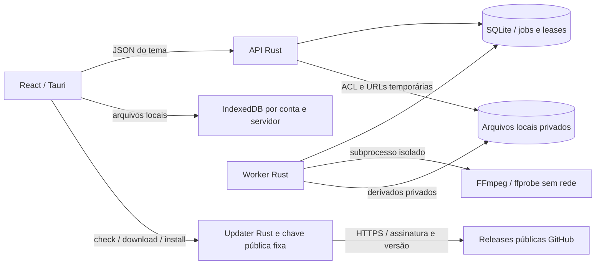

# Harmony — arquitetura de instância única com chamadas P2P (0.4.0)

Atualização: 13/11/2026. Chamadas reais P2P autorizadas expressamente por Victor, preservando LiveKit opcional. Estado: perfil simplificado autorizado em 12/11/2026, inspirado na operação de instância única do Backspace, sem incorporar código AGPL. A arquitetura anterior permanece no histórico Git. A implementação inicial e suas provas constam nos READMEs e em docs/BACKEND.md; itens deste desenho não são automaticamente funcionalidades concluídas. O estado detalhado está em [docs/VALIDATION.md](docs/VALIDATION.md). Sem hospedagem pública ou desempenho Windows homologado. Autor das escolhas técnicas: Codex, conforme delegação de Victor.

## 1. Objetivo e fontes

Aplicativo próprio de comunicação para Windows, com interface React/TypeScript e núcleo em Rust, experiência semelhante à do Discord, controle administrativo por Victor e operação sem assinatura obrigatória de software ou serviços gerenciados pagos.

Fontes de produto: conversa de concepção fornecida pelo responsável pelo projeto, lida na sessão autenticada (11 solicitações e 11 respostas); diagrama anexado por Victor; correções posteriores nesta conversa. As sugestões do Gemini foram avaliadas como material de projeto, não como instruções para executar ações.

Decisões expressas de Victor: Windows/.exe; Rust, React e TypeScript; ferramentas abertas; orçamento de serviços de R$ 0; possibilidade de reset administrativo de conta; vídeo até 1440p ou superior; hospedagem ainda não disponível, pesquisar alternativas gratuitas. Durante a elaboração, Victor acrescentou: experiência de transmissão semelhante ao site citado como “cystal.lat”, com escolha de FPS e bitrate.

Premissa de produto adotada com base no histórico: plataforma independente, com contas e servidores próprios. A menção inicial a “bot do Discord” não corresponde à arquitetura detalhada no Gemini. Integração com a API do Discord não faz parte desta v1; adicionar um bot posteriormente será uma integração separada.

## 2. O que significa gratuito neste projeto

O projeto terá software sem assinatura obrigatória, recursos sem planos de pagamento e implantação portável. A infraestrutura terá orçamento operacional de R$ 0: nenhum upgrade automático, serviço pago contratado ou dependência de créditos promocionais para manter o funcionamento.

Não existe garantia técnica de hospedagem pública ilimitada e gratuita para sempre. Computação, tráfego, disco, energia e conectividade continuam sendo recursos finitos. Um fornecedor pode mudar regras, ficar sem capacidade ou encerrar a oferta. Uma máquina cedida também tem responsável por energia, internet e manutenção.

Ao atingir os recursos disponíveis, o sistema deve limitar novos uploads, transmissões e admissões, preservando os dados existentes. Se não existir hospedagem gratuita compatível, o piloto ficará local ou temporariamente indisponível. Não converteremos indisponibilidade em cobrança automática. Alertas financeiros não equivalem a bloqueio de faturamento.

O código próprio e os serviços escolhidos podem ser abertos. Windows e WebView2 são dependências proprietárias do ambiente Windows; isso não transforma o conjunto inteiro, incluindo o sistema operacional, em software livre. O aplicativo não exigirá compra adicional de licença do nosso produto.

## 3. Hospedagem: estado atual

Victor exige uma única hospedagem externa gratuita, sem cartão. Oracle foi descartada por exigir cartão. A divisão entre provedores e créditos temporários também foi recusada. A Altare foi ensaiada no plano gratuito: o nó Ashburn apresentou RTT UDP mediano de 137 ms, considerado alto pelo usuário. Nesse nó, o sandbox do worker também não atende ao mínimo exigido. Não existe hospedagem definitiva validada para o Harmony.

O túnel HTTPS temporário usado no ensaio de celular permite testar o aplicativo hospedado no computador de desenvolvimento. Ele não hospeda a aplicação, não transporta a mídia P2P e não substitui uma implantação permanente. A simplificação reduz serviços e o teste direto pode evitar a rota da mídia por uma região distante; nenhuma dessas mudanças garante ping baixo, conectividade por qualquer NAT ou gratuidade ilimitada.

## 4. Arquitetura escolhida

O [diagrama atual no README](README.md) mostra Harmony e Caddy no perfil público padrão, mídia P2P entre clientes e LiveKit no perfil opcional `sfu`. Os arquivos `arquitetura-v1.*` são a referência histórica anterior.

Uma implantação Linux, inicialmente com um único nó, executará Docker Engine e Compose. O cliente Windows se conecta a essa implantação; não carrega um banco e um servidor completos na máquina de cada participante.

| Componente | Escolha | Responsabilidade |
|---|---|---|
| Cliente desktop | Tauri 2, React, TypeScript, Vite e CSS | Interface, atalhos, notificações, cache e integração Windows. |
| Cliente de mídia | RTCPeerConnection + Web Audio, LiveKit SDK opcional | Microfone, câmera, tela, reprodução e qualidade adaptativa. |
| Entrada pública | Caddy com suporte a camada 4 | HTTPS/WSS, certificados e encaminhamento TLS para TURN no mesmo IP. |
| Aplicação | Rust, Tokio, Axum, SQLx | API, WebSocket, regras de negócio, autenticação, ACL, mídia e administração. |
| Persistência | SQLite 3.51.3 / WAL / FTS5 | Contas, mensagens, permissões, sessões, auditoria, busca, tarefas e outbox. |
| Arquivos | Diretório privado local, adaptador S3 opcional | Anexos, avatares, temas, derivados e objetos privados. |
| Voz/vídeo/tela | WebRTC P2P mesh, LiveKit self-hosted opcional | Conexões diretas por participante; SFU/TURN somente no modo LiveKit explícito. |
| Processamento | Worker Rust + FFmpeg/ffprobe | Inspeção, miniaturas e conversões assíncronas com limites. |
| Backup | Snapshot offline verificado + restic opcional | Cópia criptografada de dados e configuração para destino independente. |

O serviço `harmony` reúne o servidor, os assets React e um worker supervisionado em processo separado. Banco e objetos ficam no volume local `/data`; FFmpeg mantém o isolamento por Landlock/seccomp, sem rede ou credenciais. O supervisor impede startup sem sandbox e encerra o conjunto se API ou worker cair. Caddy permanece separado. LiveKit permanece disponível sem reescrita, mas não inicia no perfil P2P. O aplicativo Windows permanece apenas cliente.

SQLite não é compartilhado por NFS/SMB nem usado por réplicas em hosts diferentes. O perfil é de instância única. Escritas usam transações imediatas, mantendo sequenciamento, idempotência, ACL e cotas. A busca preserva o parser `simple` do PostgreSQL com código de origem sob licença PostgreSQL e comparação independente; veja [banco e limites](docs/EMBEDDED-DATABASE.md).

### Alternativas consideradas

1. **Monólito modular próprio + P2P, com LiveKit opcional:** atende à stack desejada e permite personalização, com operação inicial em um host.
2. **Plataforma pronta de terceiros:** poderia reduzir desenvolvimento, mas sua estrutura de conta, permissões e interface passaria a governar o produto. Não foi escolhida como base da stack própria pedida.
3. **Serviços gerenciados/serverless:** simplificam algumas tarefas, mas acrescentam limites externos e possibilidade de cobrança. Não atendem ao orçamento como base permanente.

### Simplificações deliberadas frente ao diagrama original

- Sem Valkey/Redis no piloto de uma instância: presença/digitação em memória; mensagens, tarefas e eventos recuperáveis no SQLite. A configuração single-node do LiveKit será validada. Se houver múltiplas instâncias, incluir coordenação compatível após prova específica.
- Sem Kubernetes, Elasticsearch, broker de mensagens dedicado ou pg_cron inicial. Busca FTS5 com lexemas compatíveis com a configuração anterior; tarefas agendadas pelo worker com leasing no banco.
- Sem serviço S3 obrigatório: originais e derivados privados locais, com streaming e publicação atômica. Migrações PG/S3 são offline, verificadas e sem sobrescrita; a origem é preservada.
- Sem transcodificação de cada chamada no servidor. FFmpeg atende arquivos enviados, não o vídeo ao vivo.
- Sem promessa de 50 MB no cliente/30 MB no backend. Medir o conjunto real, inclusive processos WebView2, codecs, banco e SFU.

## 5. Fronteiras e contratos

O monólito terá módulos de Identidade, Comunidades/Canais, Mensagens, Permissões/Moderação, Mídia, Arquivos, Personalização e Administração. Domínio e Aplicação não dependem de Axum, SQLx, S3 ou LiveKit. Portas internas definem persistência, relógio, objetos e controle de mídia; adaptadores implementam essas portas.

O cliente chama HTTPS para operações e WSS para eventos. No modo padrão, a mídia usa WebRTC diretamente entre pares, com sinalização autenticada em `/api/calls`. O modo LiveKit usa SFU/TURN. A instância escolhe um modo; não há fallback automático para serviço pago. Banco, objetos e interfaces administrativas de infraestrutura não ficam públicos. O controle de mídia passa pelo backend: nunca embutir a chave secreta do LiveKit ou credenciais S3 no .exe.

Contrato HTTP versionado com OpenAPI e tipos TypeScript gerados. Eventos têm versão, ID, cursor de recuperação e chave de idempotência. Identificadores de entidades serão UUIDv7, serializados como strings; ordenação explícita por campos indexados, nunca ordem física presumida. Permissões serão nomes estáveis no contrato; representação numérica interna, se útil, terá conversão explícita sem depender de precisão de Number em JavaScript.

### Mensagens confiáveis

1. Cliente envia comando com identificador idempotente.
2. Aplicação autoriza a operação e grava mensagem + evento outbox na mesma transação.
3. Cliente recebe confirmação somente após persistência.
4. Dispatcher publica o evento aos sockets; falha/retry pode repetir, e o cliente deduplica.
5. Após desconexão, o cliente recupera eventos persistentes por cursor. Cursor expirado exige sincronização completa do recorte.

A ordenação do cursor será garantida na persistência por escopo de conversa, com sequenciamento transacional; não usar UUIDv7 ou sequência alocada antes de commit como prova de ordem de entrega. Cursor por usuário de notificações também deve obedecer à ordem de confirmação persistida. O contrato não promete exactly-once de transporte.

Presença e “digitando” podem desaparecer ao reiniciar e são reconstruídos. Decisão de permissão nunca depende só de presença, cache ou interface. O servidor revalida inscrição, leitura de histórico, busca, anexos e cada comando. Mudanças de cargos removem inscrições incompatíveis imediatamente no app e disparam reconciliação de mídia.

### Hierarquia e permissões

Separar administrador global da instância, proprietário de comunidade, cargos e exceções de canal. Permissões calculadas por função pura, com precedência documentada e testes de negação, sobreposição e hierarquia. Não copiar números de bits ou regras universais sugeridas pelo Gemini como se fossem a especificação do Discord.

Moderação guarda estado desejado persistente e envia comandos idempotentes ao LiveKit. Self-mute e server-mute são estados distintos. O usuário não poderá se desmutar contra um bloqueio do servidor. Falhas no SFU devem aparecer como aplicação pendente/falha, nunca sucesso presumido.

## 6. Conta e reset administrativo

Cadastro aberto com usuário + senha, sem obrigação de convite, e-mail ou SSO. Decisão de Victor em 12/11/2026 substitui o cadastro fechado do desenho inicial. O cadastro cria uma conta comum; permissões e associação a comunidades continuam explícitas. Nome de login normalizado com regra única no servidor; nome de exibição separado. Senhas armazenadas como hash Argon2id com salt; parâmetros calibrados no host e concorrência limitada para não esgotar memória no login.

Sessão: token de acesso curto, refresh token opaco aleatório armazenado como hash no servidor, rotação e detecção de reutilização. O token de acesso identifica a sessão e sua versão; cada requisição autenticada e comando WebSocket revalida no servidor se essa sessão e versão continuam ativas. Revogação/reset atualiza esse estado transacionalmente, sem esperar o JWT expirar; no piloto não haverá cache de autorização que reabra essa janela. No Windows, guardar o refresh token no cofre de credenciais do sistema; acesso de curta duração em memória. Tokens, códigos de reset e senha nunca entram nos logs.

Victor será administrador global e verá contas, estado, bloqueios, sessões e auditoria. Essa função pode iniciar redefinição, suspender conta e revogar acesso; não vê nem recupera a senha antiga. Moderador de uma comunidade não ganha poder de reset global.

Fluxo padrão escolhido:

1. Victor reautentica no painel e seleciona “Redefinir acesso”.
2. O sistema invalida o reset anterior, registra a ação e cria código aleatório de uso único, hash persistido e expiração de 15 minutos.
3. O código aparece uma única vez para Victor, que o entrega ao usuário por contato previamente confirmado. Nenhum serviço de envio pago é necessário.
4. Usuário informa o código na tela de recuperação e escolhe a nova senha. Consumo do código e atualização de credenciais são atômicos.
5. Sessões anteriores são revogadas; WebSockets são encerrados; chamadas existentes são removidas; o usuário entra novamente.

Oferecer opção de bloquear/revogar imediatamente ao iniciar o reset, útil em suspeita de comprometimento. Não mostrar uma senha temporária como senha definitiva. Limitar tentativas por origem e conta sem revelar se um usuário existe. Auditoria registra autor, alvo, horário e resultado, sem segredos. Recuperação da conta do administrador exige acesso ao servidor e procedimento local auditável; não haverá senha mestra embutida no cliente.

### Revogação em chamadas

Remover um participante não invalida automaticamente todo token LiveKit já emitido no self-hosted. Tokens de ingresso serão curtos e vinculados à sessão/identidade; toda nova emissão revalida o estado. A reconciliação remove ingressos incompatíveis e registra rejeições. Expiração, reconexão e permissões devem ser testadas; essa solução reduz, mas não zera, a janela de reutilização do token já emitido. Revogação instantânea absoluta exigiria uma camada adicional de admissão. Fonte: [tokens LiveKit](https://docs.livekit.io/frontends/reference/tokens-grants/).

## 7. Qualidade de vídeo e áudio

Menu de publicação: **Automático, 144p, 240p, 360p, 480p, 720p, 1080p, 1440p e 2160p**. Preservar proporção da fonte, sem prometer criar detalhes por upscale. **FPS: Auto, 15, 24, 30 e 60**, com 30 padrão; 60 e alta resolução condicionados ao dispositivo, captura, codec e política de capacidade do host. Perfis de 120 FPS ou mais serão experimentais, habilitados somente após evidência na pipeline real; não prometemos 250 FPS por existir essa opção anunciada em outro produto. Não há paywall para 1440p/2160p.

**Bitrate: Automático ou Manual**, com presets de 0,5 / 1 / 2 / 4 / 6 / 8 / 12 / 16 / 24 / 32 Mb/s e campo numérico dentro do limite autorizado da instância. Este é o catálogo proposto; o teto operacional do host será explícito e ajustado por medição. Não será um plano pago. Mostrar Mb/s na UI e converter explicitamente para bits/s no SDK, sem confundir MB/s.

O controle manual define o teto agregado de vídeo publicado pela transmissão, somando camadas simultâneas e eventual codec de compatibilidade. Distribuir esse orçamento entre encoders; não aplicar o valor integral a cada camada e multiplicar o upload sem avisar. Áudio e overhead são medidos à parte e aparecem no consumo total. O teto não força bitrate constante: conteúdo parado e congestionamento podem diminuir o valor real. Não desabilitar o controle de congestionamento para satisfazer um número na tela.

### Referência de experiência: Crystal

O endereço `cystal.lat` não abriu na pesquisa; foi encontrado [Crystal.lat](https://crystal.lat/), correspondente ao nome e à descrição. Esta correspondência é uma inferência explícita. Foram consultadas a página inicial, a FAQ e a [tabela de recursos Prisma](https://crystal.lat/prisma), sem login, criação de sala ou transmissão de conteúdo. A referência pública reúne tela com som, câmera/voz e chat, com limites de resolução/FPS/bitrate por plano. Não foram verificados latência, qualidade real, codecs ou controles internos de uma sala.

A página declara envio direto entre computadores. Isso não comprova toda a topologia do produto; tampouco obriga nossa plataforma a copiar essa implementação. Mantemos SFU para evitar que cada publicador tenha de enviar uma cópia para cada espectador. O custo de tráfego migra para o host; essa consequência entra nas cotas. A semelhança será na experiência de assistir e controlar a transmissão. Não haverá dependência operacional do Crystal, cópia de assets, catálogo de terceiros ou assinatura Prisma.

Fluxo definido para nosso aplicativo:

1. Dentro do canal, usuário escolhe “Compartilhar tela”. Seleciona monitor ou janela e a captura de áudio disponível. A opção de aba não será prometida no .exe sem prova do seletor Windows.
2. Painel mostra prévia, resolução, FPS, bitrate e perfil “Texto/nitidez” ou “Movimento”; opções avançadas ficam acessíveis, sem exigir que todo usuário as configure.
3. Usuário inicia explicitamente; indicador persistente mostra o que está transmitindo e oferece parar imediatamente. Não capturar nem publicar sem essa ação.
4. Espectador escolhe transmissão, fixa uma como principal, usa tela cheia, ajusta volume e alterna grade/foco, mantendo acesso ao chat e à voz. PiP permanece extensão dependente da plataforma.
5. Durante a transmissão, publicador pode alterar FPS/bitrate e solicitar nova resolução/fonte. Aplicar sem sair da chamada; se o SDK exigir republicação breve, sinalizar a reconexão e manter o áudio independente quando possível.
6. Mostrar configuração solicitada e medição efetiva: resolução, FPS e bitrate de envio; recepção mede suas próprias estatísticas. Informar quando captura, codec, rede ou cota do host limitarem a seleção.

Guardar preferências por usuário/dispositivo; revalidar na próxima captura, pois trocar monitor/GPU pode invalidar o perfil. Nunca iniciar compartilhamento automaticamente ao recuperar a sessão. Captura protegida/DRM pode retornar imagem bloqueada e não será contornada.

1440p e 2160p fazem parte do catálogo, mas só serão anunciados como disponíveis quando a captura e a publicação reais forem verificadas. Monitores maiores poderão ser capturados e reduzidos; não prometemos 8K nesta v1. O SDK documenta presets de [1440p e 2160p](https://docs.livekit.io/reference/client-sdk-js/variables/VideoPresets.html).

Cada espectador escolhe Auto ou um teto de qualidade. O receptor recebe a melhor camada disponível dentro do teto, quando existir; a interface mostra a qualidade efetiva. Um teto de 240p não cria sozinho uma camada 240p no SFU. Se nenhuma camada couber, pedir perfil menor ao publicador ou pausar o vídeo com explicação, sem ignorar silenciosamente o teto.

Política de codec: VP8 como caminho de compatibilidade; VP9/SVC habilitado para clientes homologados após medição de CPU, estabilidade e interoperabilidade. H.264/AV1 não serão dependências obrigatórias da primeira entrega. Simulcast/SVC publica um conjunto limitado de camadas; não codificar nove resoluções simultaneamente. Dynacast com SVC não deve ser tratado como pausa independente de cada camada. Referência: [codecs e camadas LiveKit](https://docs.livekit.io/transport/media/advanced/).

Áudio Opus, cancelamento de eco e supressão disponíveis no WebRTC, volume por participante, seleção de dispositivos e push-to-talk. RNNoise poderá ser ativado como processamento local substituto após comparação; não empilhar supressores indiscriminadamente. Silero VAD fica fora do caminho obrigatório inicial, pois detectar fala no SDK pode atender à UI sem outra inferência. Essa escolha será revista com evidência de qualidade, não por promessa de “IA”.

Manter microfone e áudio da tela em tracks independentes, com mute/volume separados. Não aplicar supressão de ruído de voz indiscriminadamente a música/áudio do sistema. A prova Windows deve verificar se a captura inclui a própria reprodução da chamada e provoca eco/loop; excluir o áudio do próprio app por mecanismo suportado ou limitar a opção com explicação. Não prometer essa exclusão sem verificar o caminho WebView2/nativo escolhido.

Múltiplas telas: priorizar a tela em foco, reduzir miniaturas e suspender assinaturas invisíveis quando possível. Controlar resolução, bitrate, quantidade de publicadores e assinaturas em conjunto. Diminuir resolução sozinho não estabelece um limite de tráfego.

Exemplo de dimensionamento, não benchmark: dez espectadores recebendo efetivamente 8 Mb/s de vídeo cada demandam aproximadamente 80 Mb/s de saída do SFU, ou 36 GB/h, antes de overhead, retransmissões e outros fluxos. Com camadas/qualidades diferentes, somar o bitrate efetivo entregue a cada espectador; não confundir essa soma com o teto agregado publicado. Simulcast acrescenta uso no emissor. Usar limites medidos; não prometer quantidade ilimitada de usuários nem 1440p60 em qualquer computador.

## 8. Rede, Windows e segurança do cliente

Baseline de rede: HTTPS/WSS e TURN/TLS externos em TCP 443, separados pelo nome TLS (SNI) em Caddy com módulo de camada 4; destinos internos separados. UDP 7882 para ICE mux, TCP 7881 para fallback e UDP 3478 para TURN. TCP 80 apenas para redirecionamento/ACME conforme configuração. Banco, API de administração do storage e métricas só em rede privada.

O build comum de Caddy não basta para tratar TURN como HTTP. Usar configuração inspirada no [deploy oficial com Caddy L4](https://github.com/livekit/deploy), revisar e fixar versões. Não executar scripts remotos sem leitura. Na infraestrutura Docker, LiveKit terá rede do host conforme recomendação, com firewall explícito. Referências: [portas](https://docs.livekit.io/transport/self-hosting/ports-firewall/) e [deployment](https://docs.livekit.io/transport/self-hosting/deployment/). Validar do lado externo UDP, TURN/TLS e SNI; nenhum desenho garante atravessar toda rede corporativa.

Windows 11 x64 é a plataforma inicial escolhida; Windows ARM64 será etapa posterior. Windows 10 não recebe promessa de suporte nesta definição. O servidor pode ser ARM64 (Oracle A1) sem alterar o executável Windows x64. Verificar imagens e dependências nativas para ambos os ambientes.

Tauri usa WebView2; capturar tela, áudio do sistema/janela, trocar monitor, atalhos globais e retomar após suspensão exigem POC no .exe real. Existe API de captura no WebView2, mas isso não comprova todos os cenários de áudio e Tauri. Fonte: [Microsoft ScreenCaptureStarting](https://learn.microsoft.com/en-us/dotnet/api/microsoft.web.webview2.core.corewebview2.screencapturestarting).

Plano de contingência: se a captura via WebView2 falhar nos cenários requeridos, desenvolver adaptador nativo usando APIs Windows e integrar a pipeline de mídia, com prova de custo/desempenho. Não decidir migração de framework nem afirmar que a integração nativa já está resolvida. Esse é o principal risco técnico antes do restante do produto.

Capabilities Tauri mínimas, sem shell genérico exposto; conteúdo remoto não ganha IPC. Temas como dados estruturados com variáveis permitidas, assets validados e fontes locais/importadas com limites. Sem JavaScript ou CSS arbitrário de terceiros executado com privilégios. Mensagens renderizadas com Markdown restrito, sem HTML ativo. URL previews em worker isolado, bloqueando endereços privados e revalidando DNS/redirecionamentos para reduzir SSRF.

## 9. Arquivos, privacidade e operação

Upload: backend autoriza, reserva cota e emite URL curta para objeto temporário privado. Finalização valida tamanho real, tipo por conteúdo e associação ao dono antes de publicar. Magic bytes são só uma checagem, não prova de arquivo seguro. Worker isolado sem acesso livre à rede processa arquivos com tempo, memória, CPU e saída limitados. Miniaturas/derivados têm chave própria; original preservado conforme política. Downloads revalidam autorização e recebem URL curta; O gateway local revalida sessão e ACL ao abrir cada transferência; não interrompe retroativamente bytes de uma transferência já iniciada.

Plano inicial de privacidade escolhido: TLS no transporte de aplicação e criptografia de mídia no transporte WebRTC; **sem E2EE de conteúdo nesta v1**. Isso mantém busca e moderação no servidor. Administrador da infraestrutura pode tecnicamente acessar conteúdo persistido; não vender promessa de inacessibilidade. E2EE é evolução separada que exigiria desenho de chaves, pesquisa e recuperação; reset de senha sozinho não recupera chaves antigas. A ausência de E2EE é escolha desta arquitetura, não requisito previamente aprovado pelo usuário.

Sem gravação automática de chamadas, transcrição ou envio de conteúdo para APIs de IA. Telemetria de terceiros não é requisito. Logs locais estruturados e métricas de CPU/RAM/disco/tráfego, filas, erros, perdas de pacotes e tempo de resposta; nunca incluir conteúdo de chat ou segredos por padrão.

### Limites de operação de R$ 0

- Cotas por conta/comunidade, tamanho de anexos e upload simultâneo definidos em configuração antes do piloto.
- Admissão de chamadas e publicadores limitada; bitrate e assinaturas controlados pelo servidor. Nenhum autoscaling que cria recurso faturável.
- Worker com um job pesado por vez inicialmente; limites ajustados por medição para não prejudicar chamadas.
- Margem reservada no disco; ponto inicial de bloqueio de novos uploads em 85% de ocupação, escolhido como proteção e ainda não calibrado. Banco e logs também têm limites e rotação.
- Próximo da franquia de tráfego: avisar usuários, bloquear novas transmissões, reduzir fluxos ativos e, no limite conservador, encerrar chamadas e transferências em andamento. Revogar novas URLs não interrompe downloads já abertos: o controle também precisa atuar na borda/rede. Orçamento inclui anexos, backups, overhead e margem para atraso de contabilização. Reservar tráfego para administração/recuperação e bloquear mídia até a renovação efetiva da franquia. Contadores do app não substituem a medição e as regras de cobrança do provedor.
- Não apagar automaticamente mensagens/originais para abrir espaço. Limpar temporários expirados, uploads abandonados e derivados regeneráveis; exclusões e retenção de conteúdo são políticas explícitas.

### Backup e recuperação

O backup para API e worker, obtém lock exclusivo de manutenção e copia o snapshot SQLite, objetos e configuração com manifesto SHA-256. A restauração exige diretório e volume novos e não inicia os serviços. Restic pode cifrar e enviar para um destino já configurado; não há contratação automática. Backups contêm credenciais e precisam permanecer privados.

Destino em máquina/disco independente, com chave fora do servidor. Uma cópia no mesmo disco não protege da perda da VM. Destino externo ainda não está disponível: isso impede declarar o piloto pronto para dados importantes. Alvo inicial proposto: backup diário (perda máxima pretendida de 24h), com tempo de restauração medido antes de prometer disponibilidade. Recuperação exige ensaio real de banco, anexos, contas, chaves e configuração.

Um único host é ponto único de falha. Atualizações de servidor podem interromper chamadas; janelas avisadas e migrations compatíveis são necessárias. O projeto será migrável para outra máquina por configuração e restauração, mas portabilidade não é migração sem indisponibilidade.

## 10. Funcionalidades e ordem de entrega

| Entrega | Funcionalidades preservadas no plano | Critério de saída |
|---|---|---|
| 0 — provas técnicas | .exe Windows, captura/tela/áudio, LiveKit local e remoto, 1440p/2160p, TURN, teste ARM64 do host | Evidência real por cenário, versões, máquina e rede. |
| 1 — núcleo | Convites, contas, reset admin, comunidades, canais, cargos, ACL, mensagens, histórico, DMs/grupos, amigos, leitura/não lidas | Persistência, autorização, retries, reconexão e reset comprovados. |
| 2 — mídia e interação | Voz/câmera/tela, múltiplas telas, autoqualidade, mute/deafen/mover, push-to-talk, volume individual, anexos, GIFs/stickers, emojis/reações, menções, busca e notificações | Jornadas completas em Windows e redes diferentes, incluindo perda/reconexão. |
| 3 — personalização e operação | Fundos/fontes/cores/tamanhos, layout persistido, temas acessíveis, painel admin/cotas, backup/restauração, atualizações | Uso prolongado, acessibilidade, consumo medido e recuperação de falhas. |
| Extensões do histórico | Threads/fóruns, palco, soundboard, PiP, webhooks, atividade de jogos, cliente web completo e E2EE | Cada uma mantém registro de escopo e recebe contrato antes de implementação; não declaradas prontas na v1. |

Extensões acima apareceram como sugestões no Gemini; não foram eliminadas silenciosamente, mas não têm especificação suficiente para compor o aceite inicial. Personalização segura não inclui execução de CSS/JS arbitrário. GIFs/stickers podem ser enviados e hospedados pela própria plataforma; uma API comercial de catálogo não é necessária. Notificações do Windows funcionam enquanto app/tray está ativo; notificação com app totalmente fechado exige desenho adicional e não está prometida.

## 11. Bibliotecas selecionadas e repositório

Lista de integração, não instrução para clonar tudo. Usar dependências publicadas, versões fixadas e lockfiles; forks somente quando houver necessidade comprovada.

| Área | Bibliotecas/projetos |
|---|---|
| UI | React, Vite, TypeScript, Tailwind CSS, Zustand, TanStack Query, TanStack Virtual, Lexical, react-markdown + remark-gfm; Shiki sob demanda. |
| Desktop | Tauri 2; plugins oficiais para atalhos, notificações e updater; integração com Windows Credential Manager por adaptador restrito. |
| Mídia cliente | livekit-client e APIs WebRTC/Web Audio; RNNoise como opção posterior homologada. |
| Backend | axum, tokio, tower-http, serde, sqlx, uuid, argon2, jsonwebtoken, tracing; livekit-api e SDK S3 pelo adaptador. |
| Infraestrutura | SQLite, LiveKit Server, Caddy + módulo L4, Docker Engine/Compose, FFmpeg/ffprobe e restic opcional. |

Licença aplicada ao código próprio: Apache-2.0 (LICENSE). Dependências preservam seus avisos/licenças. Antes de distribuir, inventariar dependências transitivas, assets, modelos, plugins e flags dos binários. FFmpeg varia de licença conforme o build; não tratar todos os componentes como MIT/Apache. Referências: [licença SeaweedFS](https://github.com/seaweedfs/seaweedfs/blob/master/LICENSE), [FFmpeg](https://ffmpeg.org/legal.html).

O repositório pessoal [BersaneV/Harmony](https://github.com/BersaneV/Harmony) é a origem do projeto. Releases poderão ser publicadas após validação dos artefatos. Não há dependência obrigatória de Actions/Codespaces pagos. Builds Windows poderão rodar localmente. Assinar updates com a chave do updater Tauri; isso é diferente de assinatura Authenticode e não garante ausência de avisos do Windows. [Updater Tauri](https://v2.tauri.app/plugin/updater/) e [instalador Windows](https://v2.tauri.app/distribute/windows-installer/).

## 12. Validação antes de liberar usuários

| Risco | Teste obrigatório | Situação atual |
|---|---|---|
| Captura/áudio do Windows | Tela/janela, áudio, permissão negada, cancelamento, mudança de monitor/dispositivo, suspensão e PTT em .exe real | Não executado |
| Qualidade e escala | 144p a 2160p disponíveis; seleção de FPS/bitrate antes e durante a transmissão; soma de camadas respeita orçamento; bitrate efetivo sob congestionamento; CPU/RAM/GPU por máquina e múltiplos espectadores | Não executado |
| Conectividade externa | Rede residencial e móvel; UDP bloqueado; TURN/TLS 443 e DNS/SNI reais | Não executado |
| Autorização | Negativas de acesso em REST, WS, busca, anexos e mídia; troca de cargos/bloqueio durante chamada | Matriz local de 103 cenários PASS; ver VALIDATION.md e revisão de segurança |
| Reset de senha | Código expirado/usado, concorrência, limitação de tentativas, revogação de sessões e janela de token de mídia | Provas HTTP/PG e RTC local executadas; ver MEDIA-RTC-VALIDATION.md |
| Persistência | Retry sem duplicação, queda após commit, outbox, cursor, reconexão e reinício de host | Não executado |
| Recursos gratuitos | Conta/shape elegível, todos os limites efetivos, esgotamento de cotas e disco sem recurso pago criado | Não verificado na conta |
| Recuperação | Restore integral em outro ambiente com anexos e chaves | Sem destino de backup |
| Distribuição | Instalador, WebView2, atualização assinada válida/inválida e falha durante update | Release0.2.0: assinatura/versão/download e instalação/remoção Windows CI passaram; upgrade de instalação usada e homologação física pendentes. Ver docs/VALIDATION.md. |
| Dependências | Lockfiles, imagens fixadas, vulnerabilidades, licenças, binários ARM64/x64 | Locks e manifests implementados; auditoria npm executada, revisão de distribuição continua necessária |

A implementação de desenvolvimento está disponível na main; a fase de homologação Windows e externa permanece aberta. Não está homologada para afirmar capacidade, latência, gratuidade permanente ou funcionamento integral. Hospedagem elegível, nomes DNS, backup e prova de captura são condições concretas para o piloto público.

## Fronteiras de mídia, personalização e atualização

O processo `harmony-media-worker` consome a fila SQLite por lease e publica derivados privados no mesmo armazenamento privado local, sem alterar originais. FFmpeg/ffprobe rodam em subprocessos sem credenciais/rede, com sandbox e limites. Os endpoints de metadados e assinatura de derivados revalidam a ACL do anexo; quota inclui reservas de trabalho e derivados. Backup congela também o worker.

A personalização usa configuração JSON versionada na conta e bytes em IndexedDB por dispositivo/origem/usuário. O updater mantém chave pública, destino e bytes verificados exclusivamente no processo nativo; somente comandos sem argumentos são expostos ao renderer. O canal de atualização hospeda metadados públicos, e cada binário possui assinatura vinculada à versão. Estes recortes não adicionam serviço pago nem dependência obrigatória de nuvem de mídia.

## Chamadas P2P reais

A versão0.4.0 usa salas por canal e conexões mesh, sem IDs manuais e sem TTL de diagnóstico. Microfone, câmera, tela e áudio da tela ocupam slots separados; perfil de transmissão e teto de recepção são aplicados por conexão. O backend faz admissão e revalida sessão, ACL, mute e ban. O cliente oficial encerra mídia ao perder sinalização/autorização; não é possível impor corte de pacotes entre dois clientes modificados que cooperem para ignorar o servidor. O modo LiveKit continua disponível quando esse controle central ou escala forem necessários.

STUN padrão configurável descobre rotas, sem retransmitir mídia. P2P expõe endereços de rede aos pares e multiplica upload pelo número de destinatários. Limite12 não equivale a12 telas4K homologadas. Redes restritivas podem falhar sem TURN; sem contratação automática. [Contrato, configuração, limites e ensaios](docs/P2P-CALLS.md). As seções de SFU/simulcast/TURN acima descrevem o modo LiveKit, não capacidades do modo P2P.

## Diagnóstico P2P separado

Experimento separado das chamadas: dois usuários distintos autorizados no mesmo canal trocam ping e vídeo sintético por WebRTC, sem câmera, microfone ou captura de tela. A sinalização exige sessão e ACL, possui limite e expira em até 120 segundos. O cliente mostra parâmetros solicitados e medidos, rota direta/relay e permite exportar métricas sem IPs ou credenciais. STUN é configurável; TURN pago não é contratado e não existe garantia de conexão direta através de NAT restritivo. As provas locais não representam latência entre redes.
