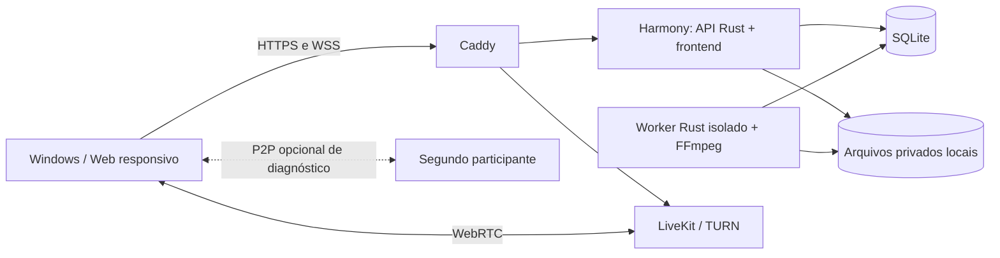

# Harmony

Comunidades, conversas e compartilhamento de tela em uma plataforma open source, hospedada por você. Cliente Windows com Tauri 2, React e TypeScript; servidor Rust com SQLite, arquivos locais privados e LiveKit.

**Versão de desenvolvimento.** O núcleo funciona com serviços reais e possui testes de integração. Execução/captura no Windows, TURN em redes externas e hospedagem pública ainda precisam das provas descritas na documentação. Não há servidor comercial nem conta obrigatória em serviço pago.

## O que já funciona

- Cadastro por convite, login, sessões rotativas e recuperação administrada, com revogação de sessões.
- Comunidades, canais de texto/voz, membros, cargos personalizados, permissões por canal, amigos, conversas diretas e grupos.
- Chat com histórico persistente SQLite, atualização ao vivo, edição, exclusão, busca, reações, leitura e retry sem mensagens duplicadas.
- Anexos privados com upload/download autorizados e prévia de imagens, GIFs, áudio e vídeo por clique.
- Voz, câmera e tela com LiveKit. Prévia antes de transmitir, controles de resolução 144p–2160p, FPS 15/24/30/60, bitrate e estatísticas efetivas. Perfis de qualidade dependem da máquina e da rede.
- Volume individual, dispositivos, push-to-talk, moderação, temas e administração de contas.
- Executável Tauri com credenciais no cofre do sistema, navegação restrita e build NSIS para Windows.

## Executar

Servidor Linux dedicado com Docker Engine/Compose:

```sh
python3 scripts/configure.py
docker compose up -d --build
```

O gerador cria segredos únicos em `.env`, ignorado pelo Git, e recusa sobrescrever uma configuração existente. A senha inicial é `HARMONY_BOOTSTRAP_PASSWORD`. Banco e arquivos ficam no volume privado `data`; a API escuta em loopback e também serve o cliente web em `http://127.0.0.1:8080`. confira [operação e configuração pública](docs/OPERATIONS.md) antes de abrir a rede.

Cliente de desenvolvimento:

```sh
npm ci
npm run dev
```

Abra a URL informada pelo Vite e conecte ao servidor. No Windows com os [pré-requisitos Tauri](https://v2.tauri.app/start/prerequisites/), `npm run desktop:build -- --bundles nsis` gera o instalador. O build não equivale à homologação de captura em hardware real.

## Verificação e documentação

```sh
cargo fmt --all --check
cargo clippy --workspace --all-targets --locked -- -D warnings
python3 scripts/with-env.py cargo test --workspace --locked -- --include-ignored
npm run typecheck
npm test
npm run build
HARMONY_TEST_STORAGE=1 HARMONY_TEST_MEDIA=1 python3 scripts/with-env.py node scripts/smoke.mjs
```

Os testes de integração exigem serviços locais e usam contas descartáveis. Veja os requisitos e limites em:

- [Arquitetura e diagrama](ARCHITECTURE.md) · [SVG](arquitetura-v1.svg) · [Mermaid](arquitetura-v1.mmd)
- [Contrato de API](docs/API.md) · [Servidor](docs/BACKEND.md) · [Cliente](apps/desktop/README.md)
- [Operação, backup e build](docs/OPERATIONS.md) · [Roadmap](ROADMAP.md)
- [Validação e pendências da versão](docs/VALIDATION.md)
- [Revisão de segurança](docs/SECURITY-REVIEW.md) · [Teste de mídia real](docs/MEDIA-RTC-VALIDATION.md)
- [Análise REA do Discord](docs/REA-DISCORD.md)



A arquitetura anterior está preservada no histórico e nos arquivos `arquitetura-v1.*`. O desenho acima representa o perfil simplificado atual. O diagnóstico P2P usa vídeo gerado e dura até dois minutos; as chamadas normais continuam no LiveKit. [Banco/migração](docs/EMBEDDED-DATABASE.md), [arquivos locais](docs/LOCAL-STORAGE.md) e [teste P2P](docs/P2P-DIAGNOSTICS.md) detalham os limites.

## Licença e custos

Código próprio sob [Apache-2.0](LICENSE). Dependências mantêm suas licenças. O [inventário de versões/licenças](docs/dependency-licenses.json) e os [avisos de terceiros](apps/desktop/src-tauri/resources/THIRD-PARTY-NOTICES.txt) são gerados a partir dos pacotes fixados; os avisos acompanham o instalador. O projeto não incorpora código ou assets proprietários do Discord/Crystal, não é um cliente alternativo autenticado no Discord e não depende desses serviços para funcionar.

Software sem assinatura não elimina consumo de internet, disco ou energia. Nenhum script provisiona recurso faturável, faz upgrade automático ou contrata hospedagem. Cotas e políticas do host precisam ser aplicadas e medidas antes de liberar o piloto. O conteúdo não é E2EE nesta versão; o administrador da infraestrutura pode acessar dados persistidos. Não há gravação automática de chamadas.

## Worker, personalização e atualizações

A versão0.2.0 acrescenta o worker de mídia privado (miniaturas, metadados e MP4 faststart), temas avançados com imagens/fontes locais e atualizações Windows assinadas com versão vinculada. Consulte [worker](docs/MEDIA-WORKER.md), [personalização](docs/PERSONALIZATION.md) e [updater](docs/UPDATES.md). A versão 0.3.0 reúne API e worker como processos separados no serviço `harmony`. A implantação usa `harmony`, `livekit` e, no perfil público, `caddy`. Requer host Linux com Landlock ABI 3 (kernel 6.2+) e falha antes de abrir a API quando o isolamento não está disponível.
