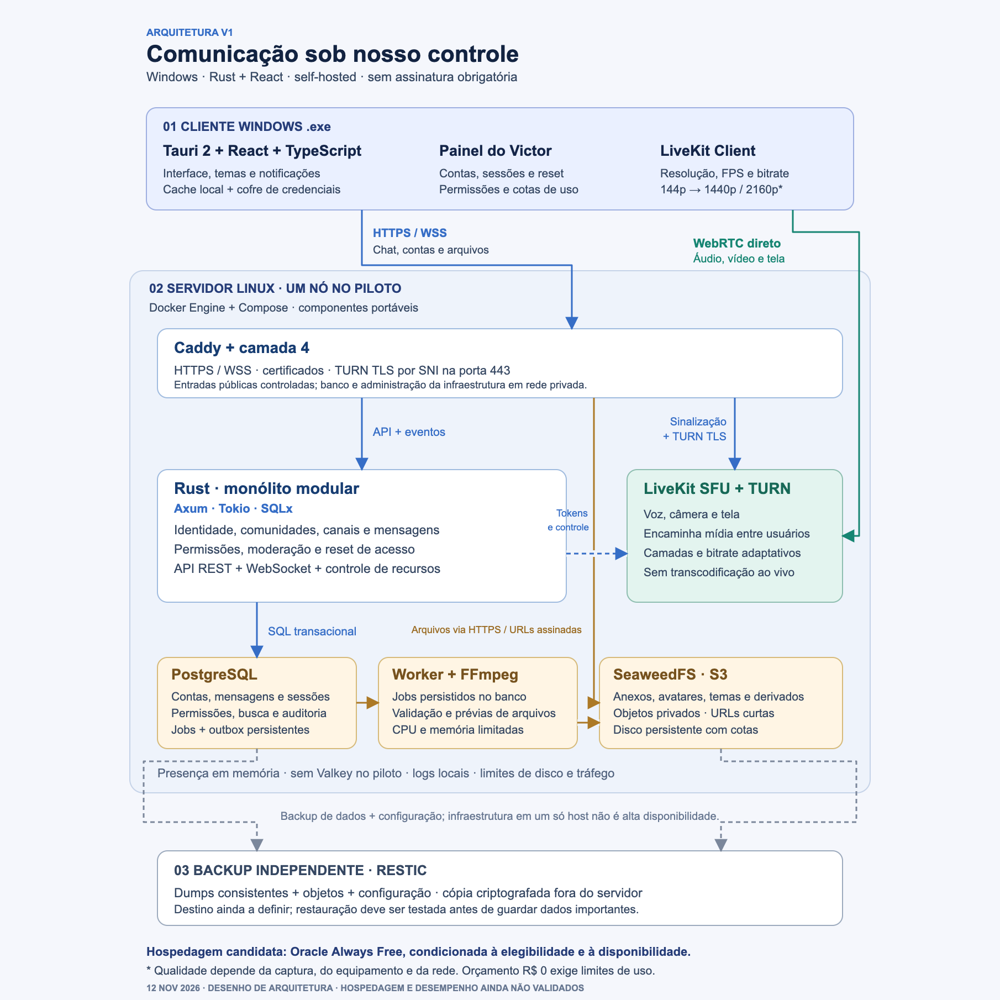

# Harmony

Plataforma de comunicação self-hosted para Windows, com Rust, React e TypeScript.

O projeto está na fase de arquitetura e provas técnicas. Ainda não há aplicativo instalável, servidor publicado ou desempenho homologado.

## Experiência planejada

- Comunidades, canais, mensagens diretas e grupos, cargos e moderação.
- Voz, câmera e compartilhamento de tela com áudio.
- Seleção de resolução, FPS e bitrate; catálogo de 144p até 1440p e 2160p, condicionado à captura e à capacidade real.
- Personalização de temas e notificações.
- Contas com usuário/senha e recuperação administrada pelo responsável pela instância.

## Arquitetura

Tauri 2 + React/TypeScript no cliente; monólito modular Rust com Axum, Tokio e SQLx; PostgreSQL; LiveKit SFU/TURN; SeaweedFS S3; worker FFmpeg; Caddy; Docker Engine/Compose e restic.

- [Arquitetura, decisões e limitações](ARCHITECTURE.md)
- [Diagrama vetorial](arquitetura-v1.svg)
- [Fonte Mermaid](arquitetura-v1.mmd)
- [Próximas entregas e validações](ROADMAP.md)
- [Acordos de contribuição](AGENTS.md)

## Gratuidade e operação

O objetivo é operar sem assinatura obrigatória e sem recursos pagos automáticos. Os limites de infraestrutura, tráfego e armazenamento continuam existindo. A elegibilidade de qualquer hospedagem gratuita precisa ser confirmada; não há promessa de capacidade ilimitada ou gratuidade permanente de terceiros.

## Estado da primeira entrega

Esta entrega contém documentação. A primeira prova de código deverá validar no Windows a captura de tela/áudio, os controles de transmissão e a conexão LiveKit em diferentes redes.

A licença Apache-2.0 foi proposta para o código próprio na arquitetura; ainda não foi aplicada. Dependências futuras manterão suas licenças e avisos.
