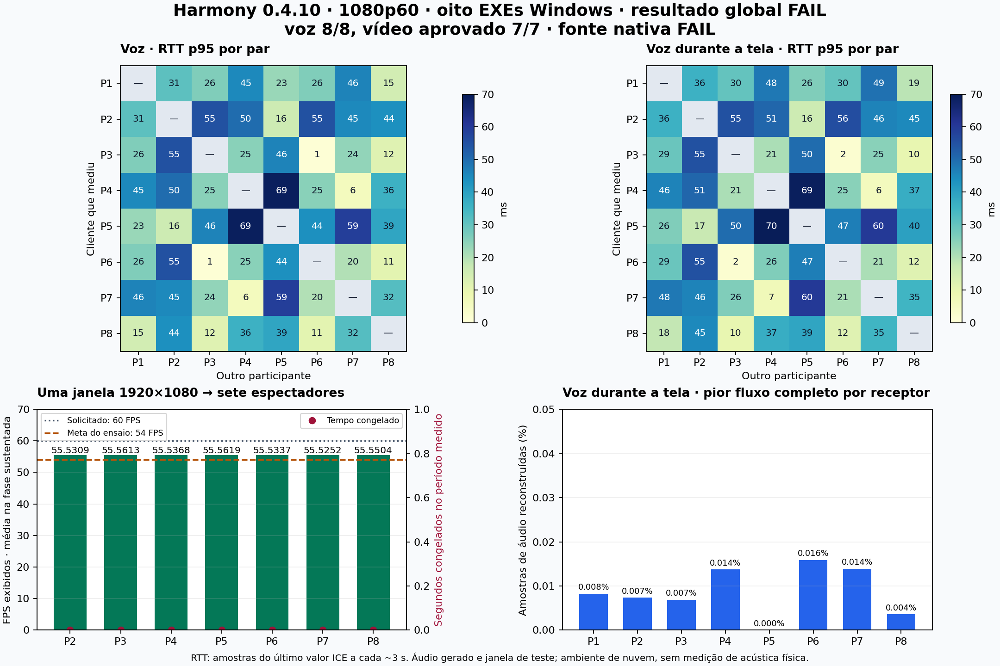
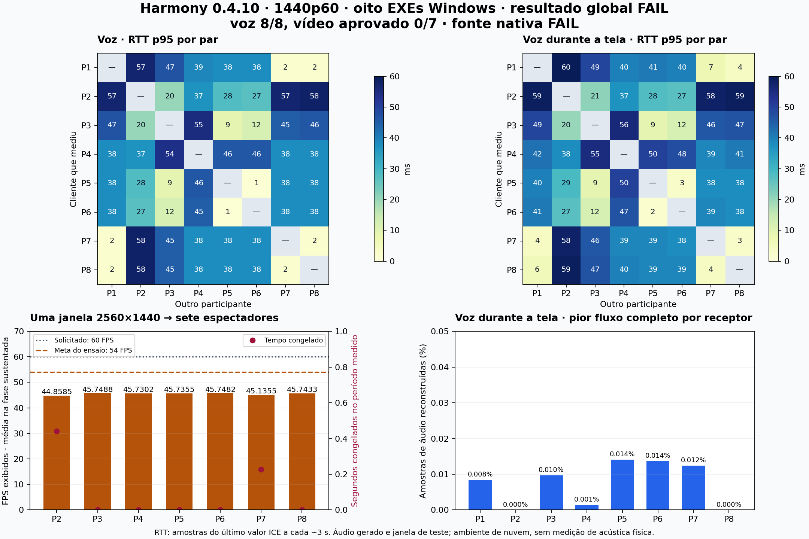
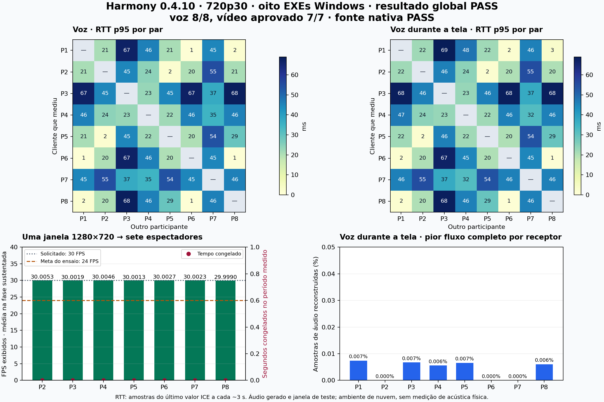

# Oito EXEs Windows e voz — Harmony 0.4.10

A meta de 1080p60 e 1440p60 continua **não atingida** nas condições medidas. A regressão de 720p30 passou. Cada campanha utilizou oito VMs Windows independentes, o mesmo instalador público e o mesmo QA; a voz passou nos oito clientes e nos 56 fluxos direcionados durante as fases de voz e de tela.

| Perfil | Resultado global | Fonte bruta / distinta (FPS) | Exibição nos sete receptores (FPS) | Resolução | Congelamentos |
|---|---|---:|---:|---|---|
| 1080p60 | **FAIL** | 55,898 / **51,343** | 55,525–55,562 | 1920×1080 integral | Zero |
| 1440p60 | **FAIL** | 45,756 / **43,287** | 44,858–45,749 | 2560×1440 integral | Três eventos em dois receptores; pior total 0,44 s |
| 720p30 | **PASS** | 30,000 / 27,573 | 29,999–30,005 | 1280×720 integral | Zero |

1080p60 reprova pela fonte distinta abaixo de 54 FPS, mesmo com os sete receptores acima de 54 FPS e sem congelamentos. 1440p60 reprova por FPS da fonte e dos receptores e por congelamentos. Os gates originais de resolução integral, fonte bruta/distinta, exibição, congelamento, voz e duração foram preservados. Os períodos medidos da fonte foram 182,2069 s, 181,8790 s e 181,7014 s, respectivamente, após a acomodação prevista pelo QA.

## Identidade e cadeia de verificação

- Fonte do pacote: `18d37162e2930d8198ffd5c66685b029e993f0e0`; [CI completa 44004759905](https://github.com/BersaneV/Harmony/actions/runs/44004759905), servidor e Windows **SUCCESS**.
- QA das três campanhas: `c76bb4b1a64616f345381c882e3b0b2a44d7dc4c`.
- [Pacote manual 0.4.10](https://github.com/BersaneV/Harmony/releases/tag/v0.4.10), sem promoção do canal automático.
- Instalador: 4.137.631 bytes, SHA-256 `cedea228dd87d72d3d7c1cec07b093e87372078151c3dd012649d8ff77906f58`.
- EXE instalado: 15.441.408 bytes, SHA-256 `378332754b2d89775a4b9d55c70ef1bfc58da63403b0d8904a2457aaabf16021`.
- Os 17 checks de atualização passaram no Windows e localmente; os nove checks de instalação/remoção passaram na VM descartável. A assinatura é Tauri/minisign, não Windows Authenticode. O download anônimo HTTP 200 confirmou os mesmos bytes e digest.
- [Prova do pacote](evidence/package-0.4.10-20261117.json). O campo de desempenho dessa prova descreve o momento da verificação do pacote, anterior às campanhas; não é aprovação de capacidade.

## Campanhas completas

| Perfil / execução | Voz | RTT ICE agregado na fase de tela: p50 / p95 / máximo | CPU total média da VM publicadora |
|---|---|---:|---:|
| [1080p60 — 44010165497](https://github.com/BersaneV/Harmony/actions/runs/44010165497) | 8/8; 28 pares e 56 fluxos | 34 / 59 / 75 ms | 70,12% de quatro processadores lógicos |
| [1440p60 — 44011488025](https://github.com/BersaneV/Harmony/actions/runs/44011488025) | 8/8; 28 pares e 56 fluxos | 38 / 58 / 66 ms | 81,01% de quatro processadores lógicos |
| [720p30 — 44012987677](https://github.com/BersaneV/Harmony/actions/runs/44012987677) | 8/8; 28 pares e 56 fluxos | 34 / 67 / 72 ms | 36,33% de quatro processadores lógicos |

O RTT é o agregado ICE do relatório, não uma medição de latência de ponta a ponta da imagem nem atraso perceptivo da voz. A CPU é da VM inteira; não atribui isoladamente uso ao encoder, à captura ou à renderização.

Cada campanha preserva oito logs integrais obtidos pela API de jobs, oito atestações, oito relatórios e 1.136 amostras únicas. As três somam 24 logs e 3.408 amostras únicas. Os JSONs abaixo preservam os resultados canônicos e acrescentam somente proveniência e observação filtrada do encoder ativo. Não usam o resumo de logs da interface como substituto da coleta integral.

### 1080p60

[JSON completo e proveniência](evidence/exe-wan-0.4.10-1080p60-20261117.json)

### 1440p60

[JSON completo e proveniência](evidence/exe-wan-0.4.10-1440p60-20261117.json)

### 720p30

[JSON completo e proveniência](evidence/exe-wan-0.4.10-720p30-20261117.json)

## Mudança e interpretação

A 0.4.10 mantém WGC, uma Vec de pixels, um SharedBuffer de leitura, cópia/publicação na UI, sequência/ACK e watchdog. O produtor pode acordar em transições reais de cópia, publicação, ACK válido, perfil ou parada, preservando o prazo calculado pelo pipeline e o temporizador anterior como fallback. Os testes Windows de sinal anterior à espera, sinal durante a espera e fallback passaram. Isso comprova esses contratos, não um ganho causal de FPS nas VMs.

Nos dois perfis de 60 FPS, o encoder VP8/libvpx acompanhou os quadros recebidos pelo media-source. A observação ativa registrou qualityLimitationReason=none nas 61 amostras de cada campanha. Esse valor não prova ausência de custo de CPU. As VMs de versões diferentes não são um controle de hardware pareado; os resultados não isolam uma causa exclusiva em WGC, cópias, renderização, agendamento ou codificação.

O escopo é uma captura nativa da janela de teste própria e voz gerada, em oito VMs públicas Windows Server 2022 com WebView2 Edge 131. Não são oito ISPs residenciais/5G, oito computadores físicos de usuários nem uma avaliação perceptiva de áudio. A geometria integral não autoriza inferir GPU física ou aceleração de hardware.

Uma [tentativa de preparação de 720p30](https://github.com/BersaneV/Harmony/actions/runs/44012833419) foi cancelada pelo executor por não ter cumprido o intervalo de espera; nenhum passo do aplicativo chegou a iniciar. Ela foi preservada e não entra como resultado de produto. A campanha válida acima começou com a sala anterior vazia e o intervalo cumprido.

A infraestrutura gratuita, o backend 0.4.3 e o feed automático 0.4.2 permanecem separados desta pré-versão manual. O experimento de duas texturas continua desligado por padrão. Ensaios curtos de prévia são diagnósticos separados e não substituem nem alteram os resultados de aceite acima.
