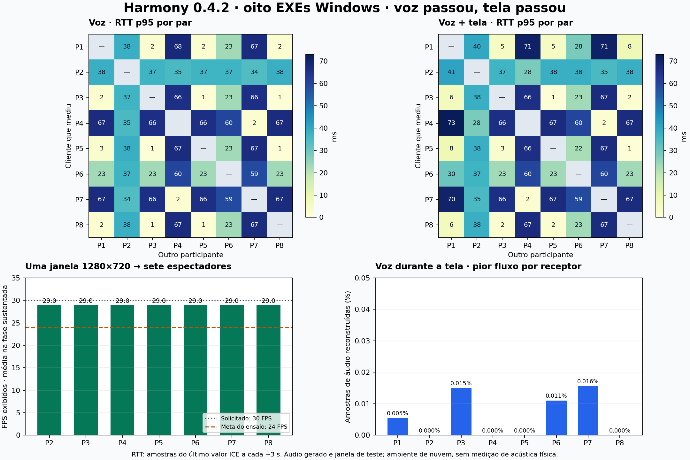

# Harmony 0.4.2 — resolução manual e teste de oito EXEs

**PASS no ensaio normal:** oito EXEs 0.4.2, oito VMs e oito endereços UDP públicos distintos; os sete espectadores mantiveram 1280×720 em todas as amostras sustentadas, com **28,9566–28,9756 FPS exibidos e zero congelamentos contabilizados**. O alvo solicitado foi 30 FPS; a captura teve mediana de 29 FPS. Voz passou nos oito clientes durante as duas fases.

[Execução 43686643520](https://github.com/BersaneV/Harmony/actions/runs/43686643520), head `82f21f7c2a93faeb277baa509c722a208ec68011`, 06:42:10–06:51:31 UTC em 15/11/2026. [Dados sanitizados](evidence/exe-wan-0.4.2-20261115.json) · [Instalador Windows x64](https://github.com/BersaneV/Harmony/releases/download/v0.4.2/Harmony_0.4.2_x64-setup.exe).

| Medida sustentada | Voz | Voz + uma tela |
|---|---:|---:|
| Conexões com certificados nativos inversos confirmados | 28 | 28 |
| Recepções direcionais de microfone | 56 | 56 |
| RTT ICE mediano | 37 ms | 37 ms |
| RTT ICE p95 | 67 ms | 67 ms |
| Maior RTT ICE observado | 75 ms | 80 ms |
| Pior perda de pacotes de voz por fluxo | 0,07739% | 0,01107% |
| Pior reconstrução de amostras de voz por fluxo | 0,05463% | 0,01561% |
| Pior p95 de jitter de voz por fluxo | 1 ms | 4 ms |
| Clientes aprovados em voz | 8/8 | 8/8 |
| Espectadores aprovados em vídeo | N/A | 7/7 |

A fase sustentada de voz durou 180,655–181,012 s por cliente; a fase com tela, 180,684–181,435 s. Cada uma começou depois de 30 s fixos de acomodação. Os percentis de RTT agregam 3.416 leituras temporais por fase, sem alegar sondagens STUN independentes. A voz não reconstruída correspondeu a pelo menos 99,9436%/99,9833% do tempo; RMS decodificado mínimo 0,3732/0,3731. Essas métricas de fala gerada não são avaliação acústica humana.

| Receptor | FPS exibidos | Resolução nas amostras | Congelamentos adicionais |
|---|---:|---|---:|
| P2 | 28,9566 | 1280×720 | 0 |
| P3 | 28,9756 | 1280×720 | 0 |
| P4 | 28,9715 | 1280×720 | 0 |
| P5 | 28,9708 | 1280×720 | 0 |
| P6 | 28,9586 | 1280×720 | 0 |
| P7 | 28,9667 | 1280×720 | 0 |
| P8 | 28,9628 | 1280×720 | 0 |

P5 terminou em 1280×720, 28,9708 FPS, zero perdas de pacotes de vídeo e zero congelamentos na fase sustentada. Todos os sete fluxos usaram H264; o envio somado de vídeo foi **3,051 Mb/s de payload**, sem áudio e overhead. A fonte é compressível e não satura o orçamento de 28 Mb/s dos sete tetos de 4 Mb/s. Não foram negociados TURN ou SFU; as rotas efetivas foram UDP srflx ↔ srflx.

O código do produto foi validado em `843aa2c6a6f6889d86b44a7c76b5fa61f34e4784`. O pacote foi gerado em `9e7a6ee4f083b7c65adad73da5d1fa69d7a80ae2`, com identidade das fontes de produto conferida por Git; diferenças somente em QA/documentação/entrega. O instalador tem **4.061.086 bytes**, SHA-256 `315fef35166b618d00fec3167b4ee7fa10d7935ae7bd3c19b36ba6ff4420f096`; EXE instalado de 15.138.304 bytes, SHA-256 `31559a726a64ae063a3e4b06b3c0fd57c55aae34b0a09fdb8b07c9437de7cb12`, igual nos oito clientes.

O [primeiro CI completo](https://github.com/BersaneV/Harmony/actions/runs/43682676291) passou todos os gates de produto Linux/Windows, assinatura e instalação, mas falhou ao criar o draft: mudanças posteriores de workflows na main fizeram o alvo exigir permissão que GITHUB_TOKEN não possui. A [retomada 43685792324](https://github.com/BersaneV/Harmony/actions/runs/43685792324) verificou os gates anteriores e a identidade das fontes, repetiu todos os gates Windows e salvou o pacote com a main estável. Não houve aumento de permissões para editar workflows, PAT novo ou exclusão de testes. Os 17 testes locais de assinatura/versão repetidos após download também passaram.

O [preflight 0.4.2](https://github.com/BersaneV/Harmony/actions/runs/43686642066) passou: captura nativa própria 1280×720, 28,9768 FPS e hash esperado do EXE. A mudança de resolução do desktop e o helper opcional do seletor não obtiveram sucesso; a seleção automática foi confirmada independentemente por HWND, geometria, conteúdo colorido e avanço de frames. Diagnósticos negativos não foram convertidos em PASS.

## Distribuição e encerramento

O canal público foi atualizado após a aprovação da rodada normal. A consulta HTTPS como 0.4.1 ofereceu a 0.4.2; o plugin oficial baixou o pacote e validou assinatura, vínculo da versão, tamanho e SHA-256 iguais aos do teste. Como 0.4.2, retornou `no_update`. Esses probes usam MockRuntime com alvo Windows x64 e não instalam no Mac. As duas respostas estão nos dados sanitizados.

Todos os jobs terminaram e os oito clientes saíram da chamada. O segredo temporário `HARMONY_EXE_WAN_SEED` foi removido; os dois segredos originais do atualizador foram preservados. A hospedagem e os dados reais permaneceram intactos. Publicação direta na main pessoal, sem PR.

## Alteração e reprodução

O perfil de movimento usava `maintain-framerate` mesmo com resolução manual. Essa preferência permite ao WebRTC reduzir a resolução durante a adaptação. A 0.4.2 usa `maintain-resolution` quando o usuário escolhe uma resolução, preservando `contentHint=motion`, teto de FPS, bitrate e escala independente de cada espectador. Movimento com resolução automática conserva a política anterior. O helper é compartilhado pelos transportes P2P e LiveKit. [Semântica das preferências](https://w3c.github.io/mst-content-hint/#degradation-preference-when-encoding).

Dois testes de regressão falharam antes da mudança e passaram depois. A suíte cliente tem 116 testes aprovados, incluindo autorização, fontes e negociação. A alteração não desliga proteção de CPU, não injeta SDP e não promete manter simultaneamente FPS, resolução e detalhe quando faltam recursos.

O [resultado anterior 0.4.1](EXE-WAN-VALIDATION.md) permanece FAIL: P5 terminou em 180p e teve seis congelamentos, somando 3,478 s. A [repetição instrumentada sem mudar o produto](https://github.com/BersaneV/Harmony/actions/runs/43681608708), fonte `46997d00116d4c769fa30a7ff5e6873a2b271a19`, passou: todos os espectadores em 720p/29,027–29,042 FPS, zero congelamentos na fase sustentada, RTT p95 66 ms. Esse PASS demonstra intermitência, não eficácia da correção. O gatilho exato da ocorrência histórica não foi isolado, pois sua coleta não continha o motivo de limitação do encoder.

## Comparação controlada, separada da aprovação de capacidade

A [execução 43683509958](https://github.com/BersaneV/Harmony/actions/runs/43683509958), fonte `0c5f55cdf3ca97f8533b6ce8f115f5a6b4045e61`, usou oito EXEs 0.4.1 em VMs distintas para comparar as duas preferências na **mesma conexão P5**, fonte nativa, codec OpenH264 e conteúdo de movimento. Cada etapa começou após cinco observações consecutivas de saída em 1280×720 e pelo menos 24 FPS. Somente essa conexão recebeu um teto artificial de 50 kb/s por aproximadamente 30 s, restaurado para 4 Mb/s; o teto de 30 FPS e o conteúdo foram mantidos. É uma intervenção diagnóstica explícita nas APIs nativas, não comportamento injetado na prova final do produto.

| Medida na etapa observada | Política anterior | Prioridade de resolução |
|---|---:|---:|
| Resoluções recebidas | 720p, 540p, 360p, 270p | Somente 720p |
| Congelamentos durante toda a etapa, incluindo o cap artificial | 3 / 1,171 s | 3 / 0,827 s |
| Após 30 s de recuperação, resolução | Somente 720p | Somente 720p |
| Após 30 s de recuperação, FPS exibidos médios | 29,226 | 29,246 |
| Novos congelamentos na janela de recuperação | 0 | 0 |

O encoder anterior indicou `bandwidth` quando seu orçamento foi limitado e reduziu a geometria; a disponibilidade estimada do link ficou em aproximadamente 5,52 Mb/s. Portanto o cap é orçamento artificial do encoder, não uma medição de banda da internet. A comparação demonstra a mudança de adaptação espacial; os congelamentos sob 50 kb/s mostram a limitação física que continua existindo. Ela não substitui o ensaio normal de 720p/30 FPS.

[Dados sanitizados da comparação](evidence/encoder-policy-20261115.json). A execução global ficou **FAIL**: todas as amostras das duas etapas e as barreiras finais foram coletadas, mas o emissor tentou restaurar a preferência depois que os outros clientes começavam a sair e recebeu erro ao avaliar um sender encerrado. Os sete receptores terminaram `DIAGNOSTIC`. A mutação final desnecessária foi removida do harness; o bitrate já tinha sido restaurado e o processo descartável é encerrado. Não reclassificar esse run como PASS.

A [primeira tentativa controlada](https://github.com/BersaneV/Harmony/actions/runs/43682467805) também permanece FAIL: a sessão HTTP do controle expirou após as coletas e os estados iniciais não eram equivalentes. Corrigiram-se a renovação rotativa e a espera pelo mesmo estado inicial. Dois testes cobrem concorrência da renovação e falha fechada; nenhum timeout, validade de token ou autorização do produto foi relaxado.

## Critérios da validação final

A prova normal deve instalar exatamente o pacote assinado com hashes de instalador e executável fixados, em oito VMs e oito egressos públicos distintos. São necessários 28 pares nativos confirmados nas duas pontas, 56 recepções direcionais de microfone por fase, 30 s de acomodação e pelo menos 180 s adicionais de voz e de voz com uma tela.

O emissor solicita 720p, 30 FPS, teto de 4 Mb/s por espectador, perfil movimento e áudio da tela desligado. O harness apenas observa a mídia e verifica a preferência nativa da 0.4.2; não modifica parâmetros no modo normal. Todos os sete espectadores devem manter 1280×720 nas amostras sustentadas, média exibida de pelo menos 24 FPS e **zero congelamentos contabilizados**. Esse último requisito é adicional ao ensaio anterior; um teste de regressão impede aprovação por média de FPS apesar de pausas ou ausência dos contadores.

Os critérios de voz permanecem: sete fluxos por cliente, áudio não reconstruído equivalente a pelo menos 80% do tempo, reconstrução de no máximo 2% e RMS decodificado mínimo de 0,03. RTT é a leitura temporal do último valor ICE, não latência completa de fala ou captura até exibição.

## Escopo e custo

As VMs são runners Windows standard de um repositório pessoal público, sem runners maiores, artifacts, caches ou relay pago. [Política de uso gratuito do GitHub](https://docs.github.com/en/actions/concepts/billing-and-usage). A hospedagem Altare existente, os dados reais e o config.toml do Codex não são alterados. O backend 0.4.1 é compatível com o cliente 0.4.2; não há mudança de protocolo ou migração.

São fontes de teste: fala gerada pelo SAPI e captura getDisplayMedia real de janela WinForms própria, usando GPU por software. IPs e identidades de VM aparecem somente como HMAC. Os oito egressos cloud não representam oito operadoras residenciais/5G. PCs físicos, eco/acústica, jogos, áudio do sistema, múltiplas telas, 1440p+, 60 FPS e uso prolongado continuam fora dessa comprovação. O gráfico e os valores efetivos devem identificar resolução, FPS e congelamentos separadamente.
