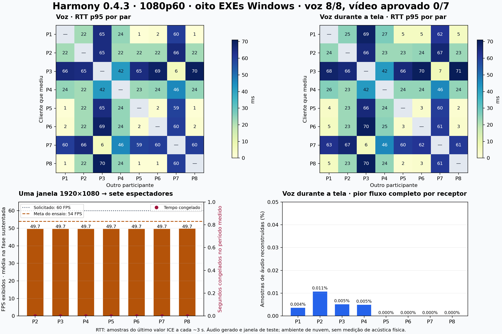
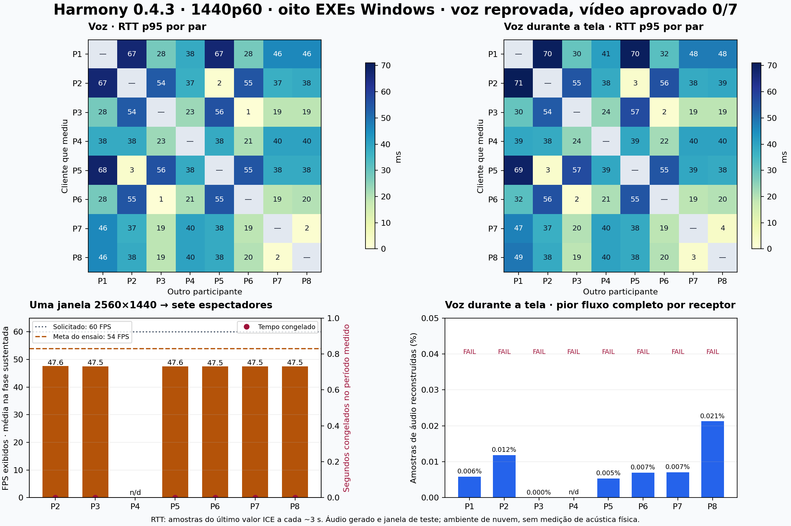

# Harmony 0.4.3 — captura nativa e um envio de tela para oito pessoas

**Os dois perfis de 60 FPS continuam FAIL.** A implementação reduziu sete codificações VP8 para uma publicação de tela no SFU opcional e acrescentou captura WGC nativa. A voz permanece em malha P2P. Os resultados medidos foram superiores aos da 0.4.2, porém não sustentaram o mínimo de 54 FPS. As rodadas usam VMs diferentes e não isolam o efeito de cada alteração.

| Rodada completa com voz e tela | 1080p60 | 1440p60 |
|---|---:|---:|
| Execução | [43798727060](https://github.com/BersaneV/Harmony/actions/runs/43798727060) | [43799308968](https://github.com/BersaneV/Harmony/actions/runs/43799308968) |
| Resolução sustentada | 1920×1080 nos sete receptores | 2560×1440 em seis receptores completos |
| FPS médios exibidos |49,6714–49,6994|47,4635–47,5721|
| Fonte nativa: quadros/s / conteúdo distinto/s |49,7006 /46,4923|47,5648 /44,6932|
| Congelamentos |Zero nos sete|Zero nos seis completos; P4 perdeu a chamada|
| Voz durante a tela |PASS 8/8, 56 fluxos|FAIL: P4 fechou todas as conexões, 42 fluxos completos restantes|
| RTT de voz mediano / p95 / máximo |24 /69 /73 ms|37 /67 /86 ms, sem comprovar continuidade de P4|
| Payload de vídeo enviado |2,539 Mb/s|3,793 Mb/s|
| Teto manual do único envio |8 Mb/s|16 Mb/s|
| Envios de tela após handoff |1 SDK + 0 P2P|1 SDK + 0 P2P|

[Dados 1080p](evidence/exe-wan-0.4.3-1080p60-20261116.json) · [Dados 1440p](evidence/exe-wan-0.4.3-1440p60-20261116.json). A fonte do produto é `98988802c6cf0975ca38ead5da0dae0f33cef5e6`; o harness das duas rodadas é `aafe79ed556769373b67ee192f6d43d1dfb325a1`. O pacote real assinado foi verificado antes dos ensaios. Instalador SHA-256 `38203a75c62cbefa80d8af5b4e7012e1f270f63c554a8de2fc613047ef1510d2`; EXE instalado SHA-256 `a4c9970dc648378e6b6d29359b7ea1a9d46e447999b2911c1770f6da52870928`.

## O que o teste comprova

Oito EXEs em oito VMs Windows 2022 standard públicas, com oito egressos TCP e oito endereços UDP selecionados distintos. Os 28 pares de voz foram conferidos por certificados inversos. Cada fase teve 30 segundos de acomodação e pelo menos 180 segundos de medição. O áudio gerado e a janela própria não usam microfone nem câmera de pessoas. A imagem de 1920×1080 ou 2560×1440 é nativa, com verificação de pixels na superfície completa; não há upscale para satisfazer o gate.

A configuração 60 FPS não substitui medição. A aprovação exige 54 FPS médios exibidos, resolução integral, zero congelamentos e, na fonte nativa, 54 quadros/s e 54 marcadores distintos/s sustentados por 180 segundos. Nenhum desses limiares foi reduzido. O preflight também permanece marcado FAIL quando não passa; o ensaio posterior é mantido para medir a cadeia completa.

Em 1080p a voz passou nas duas fases; a pior reconstrução durante a tela foi 0,010764% e o pior p95 de jitter 2 ms. A tela usou VP8/libvpx por software; o tempo médio observado do encoder foi 13,494 ms/quadro. `qualityLimitationReason=none` e durações CPU/bandwidth zero não isolam a causa do limite. Não há prova de que três camadas temporais sejam o gargalo. Um envio não significa redução equivalente de bitrate em todo conteúdo: são payloads medidos nesta janela gerada.

O RTT de vídeo ao SFU foi separado do RTT P2P de voz. A infraestrutura gratuita existente fica na Suécia; não se pode apresentar o RTT de voz como atraso completo da transmissão. Captura, codificação, jitter buffer e reprodução adicionam tempo que o RTT ICE não mede.

O cruzamento de contadores também situa o limite antes da rede: no mesmo intervalo de 1080p, o track recebeu 9.047 quadros e o encoder enviou 9.046; em 1440p foram 8.630/8.631. O contador do produtor Rust já estava em aproximadamente 50,2/48,0 FPS medianos. Esse ciclo inclui a espera pelo ACK JavaScript e não identifica sozinho captura, cópia ou agendamento como causa. A janela gerada continuou perto de 60 atualizações/s. [Contadores e método](evidence/capture-pipeline-0.4.3-20261116.json).

## Falhas preservadas e correções posteriores

A primeira [rodada 1080p](https://github.com/BersaneV/Harmony/actions/runs/43797910064) passou voz 8/8, mas parou antes de publicar a tela: o preflight entregou 55,3895 quadros/s e 52,390 marcadores distintos/s. [Seu resultado FAIL foi preservado](evidence/exe-wan-0.4.3-1080p60-initial-20261116.json). O rollup do GitHub omitiu o relatório final de P1; apenas a linha REPORT ausente do mesmo job foi agregada antes da exportação, sem duplicar amostras.

Na rodada 1440p, P4 estava com oito conexões ativas em 03:48:52,137 UTC. O servidor observou fechamento iniciado pelo cliente em 03:48:53,938; no cliente todas as conexões estavam fechadas em 03:48:55,148. A limpeza do ensaio só começou depois, em 03:49:58. O gatilho não ficou registrado e permanece NOT_VERIFIED. Uma falha isolada do SFU não explica sozinha a retirada dos sete peers de voz. Não se atribuiu a queda à CPU, ao runner ou à rede sem evidência. A instrumentação posterior registra apenas eventos de ciclo de vida e códigos sanitizados do próprio Harmony, sem tokens, conteúdo de chat ou SDP.

A [regressão 720p30](https://github.com/BersaneV/Harmony/actions/runs/43800054740) passou a fase de voz e falhou antes da tela porque uma fonte 1280×720 foi limitada a 960×540. [Dados da rodada](evidence/exe-wan-0.4.3-720p30-20261116.json). Um [probe Windows com prova de dimensões físicas](evidence/capture-geometry-0.4.3-20261116.json) confirmou metadados transitórios 960×720 antes do primeiro quadro: a prévia derivava largura máxima 960 usando a proporção inicial. O mesmo cálculo existia na 0.4.2. A 0.4.4 remove essa derivação prematura e observa um quadro real nas operações da engine, preservando os limites H264. Porém, sua prévia browser ainda apresentou 960×540 no [teste posterior](EXE-WAN-0.4.4.md); a alteração não resolveu toda a cadeia de negociação e a pendência continua aberta.

## Comparação e limites

A 0.4.2 havia entregue cerca de 24,27 FPS em 1080p e 10,20 FPS em 1440p com sete encoders. A 0.4.3 entregou cerca de 49,7/47,5 FPS com um encoder. [As provas anteriores permanecem intactas](EXE-WAN-HIGHRES.md). A 0.4.4 remove outra cópia integral na captura nativa sem resize e altera a confirmação da geometria inicial; suas calibrações isoladas e limitações estão nas [notas da candidata](releases/0.4.4.md). Não usar calibração do núcleo nem testes locais de oito navegadores como aprovação do EXE em WAN.

Os testes usam somente runners standard de repositório público e a alocação gratuita Altare já existente, sem cartão, upgrade ou recurso pago. Backend e distribuição de tela permanecem externos ao Mac. O canal automático continua na 0.4.2. Não há medição de GPU física, acústica/MOS, redes residenciais/5G, NAT restritivo, várias telas/câmeras ou operação prolongada. Zero congelamentos só se aplica aos fluxos completos enumerados, não compensa a queda de um participante nem aprova 60 FPS.
