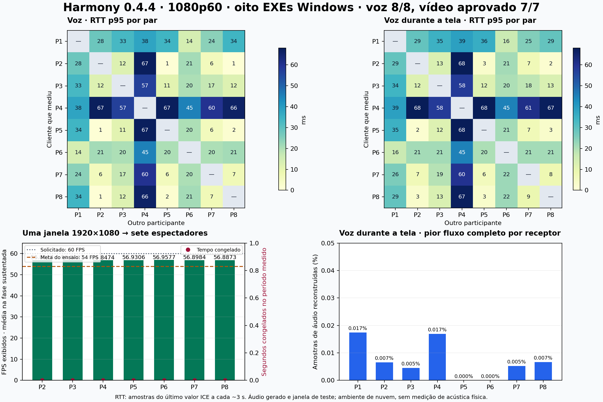
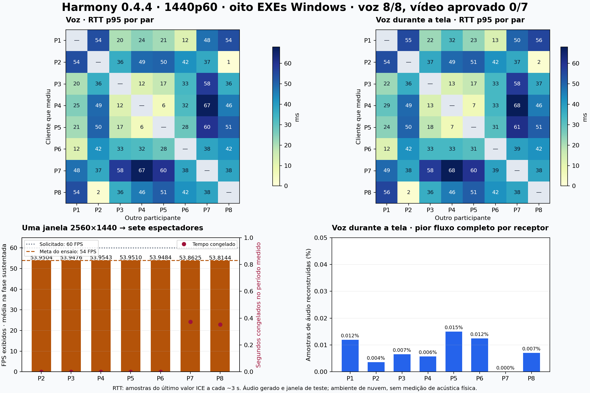

# Harmony 0.4.4 — oito EXEs com captura nativa e voz

**1080p60 passou nos critérios do ensaio. 1440p60 continua reprovado.** O critério usa pelo menos 54 FPS médios exibidos, resolução integral e zero congelamentos por 180 segundos. A taxa configurada de 60 FPS não equivale a 60 FPS exatos medidos, nem garante o resultado em qualquer hardware ou rede.

| Medição com voz e tela | 1080p60 solicitado | 1440p60 solicitado |
|---|---:|---:|
| Execução | [43814735660](https://github.com/BersaneV/Harmony/actions/runs/43814735660) | [43814737471](https://github.com/BersaneV/Harmony/actions/runs/43814737471) |
| Resultado |PASS|FAIL|
| Resolução nos sete receptores |1920×1080|2560×1440|
| FPS médios exibidos |56,8474–56,9577|53,8144–53,9543|
| Congelamentos |Zero nos sete|P7: dois/0,374 s; P8: dois/0,352 s; demais zero|
| Fonte: quadros/s / conteúdo distinto/s |57,9211 /54,5525|53,9407 /49,9098|
| Voz nas duas fases |PASS 8/8, 56 caminhos|PASS 8/8, 56 caminhos|
| RTT de voz mediano / p95 / máximo com tela |20 /67 /69 ms|37 /60 /69 ms|
| Pior reconstrução de amostras de voz |0,01747%|0,01499%|
| Pior p95 de jitter de voz |1 ms|1 ms|
| Payload de vídeo do único envio |2,7695 Mb/s|4,1284 Mb/s|
| Teto de vídeo configurado |8 Mb/s|16 Mb/s|
| CPU da VM publicadora inteira |51,99% de quatro cores|74,50% de quatro cores|

[Dados 1080p](evidence/exe-wan-0.4.4-1080p60-20261116.json) · [Dados 1440p](evidence/exe-wan-0.4.4-1440p60-20261116.json). O teste de rede confirmou oito VMs, oito egressos HTTPS e oito endereços públicos UDP selecionados distintos, com 28 pares de certificados inversos. As duas fases de cada perfil usam 30 segundos de acomodação e pelo menos 180 segundos de medição. São Windows 2022 standard públicos com áudio e janela gerados; não equivalem a PCs físicos, oito operadoras residenciais/5G ou qualidade acústica/MOS.

## Mudança no aplicativo

A captura WGC nativa sem resize copia staging→Vec diretamente, evitando o DIB intermediário e uma cópia integral por quadro. O caminho com resize continua HALFTONE. Consentimento, tamanho máximo de buffers, pacing, um lease compartilhado com ACK e watchdog permaneceram ativos. A engine resolve a geometria de um quadro real antes de impor largura; falhas ao preparar uma nova fonte preservam o vídeo e o áudio anteriores.

A tela usa um único encoder VP8/libvpx por software no SFU opcional. Foram confirmados `L1T1`, ausência de `x-google-flag:conference`, um envio SDK e zero envios P2P de tela após o handoff. Microfones continuam nos sete peers P2P de cada cliente. A CPU registrada abrange Windows, fixture, app e observação; não mede CPU do encoder isoladamente. O contador Windows não soma IRQ novamente ao tempo de kernel.

A 0.4.3 havia medido aproximadamente 49,7 FPS em 1080p e 47,5 FPS em 1440p. Os [resultados anteriores](EXE-WAN-0.4.3.md) permanecem preservados, com a queda de P4 e a falha de 720p. São VMs diferentes; a comparação não isola causalmente o ganho de cada alteração.

## Falhas e limites ainda abertos

Em 1440p a falta de cadência aparece no ciclo local do emissor antes da rede. Já os quatro incrementos de congelamento de P7/P8 coincidem com perda RTP, NACK e descarte de frames nos respectivos receptores. Os outros cinco não congelaram. Essa correlação não distingue, sozinha, rede, SFU, VM e playout como causa. Não há autorização para arredondar 53,95 para 54, ignorar pausas ou reduzir os critérios. A queda geral de P4 da 0.4.3 não se repetiu nestas duas rodadas; sua causa histórica permanece não comprovada.

A prévia browser 720p ainda entregou 960×540 para uma janela física 1280×720. O [probe](https://github.com/BersaneV/Harmony/actions/runs/43814338824) e o [diagnóstico controlado](https://github.com/BersaneV/Harmony/actions/runs/43815865685) preservam a falha. As primeiras quatro alternativas de opções GDM, na mesma VM/EXE/HWND, não a resolveram. Não existe aprovação da regressão 720p nesta candidata. O canal automático permanece na 0.4.2.

Os primeiros probes 0.4.4 de 1080/1440 pararam antes da captura por uma verificação da fixture que não aceitava o sufixo `LIFETIME_SECONDS 600`. A correção do harness foi reproduzida RED/GREEN e manteve dimensão, FPS e prazo. A repetição 1080p passou com 57,8925 quadros/s e 55,1928 distintos/s. A repetição 1440p falhou com 55,0945/51,2949. Todas as falhas permanecem registradas; calibração isolada não substituiu o teste completo.

## Proveniência e integridade

Fonte do produto/tag: `664435a324cef911b6a1a8d459591a11cc8e88af`. Harness das duas matrizes: `e66e6e210bc528505ccd4786db64fdf92fb1ec30`. O [CI assinado](https://github.com/BersaneV/Harmony/actions/runs/43808917526), instalação/remoção e 17 verificações do updater passaram. [Prova do pacote](evidence/package-0.4.4-20261116.json). A assinatura é do updater Tauri e não é Authenticode.

O instalador tem 4.131.150 bytes, SHA-256 `6e1c29cd60e5dae91bfb6a0d4a0664c5ab67b0192e993a06f001e7330c9a53fa`; o EXE instalado tem 15.438.848 bytes, SHA-256 `a232f9d287964c61f0badf90a8adc5f175ca4fd6f5a215ebf139446548cd0945`. [Candidata pública](https://github.com/BersaneV/Harmony/releases/tag/v0.4.4). Backend e Web hospedado continuam 0.4.3, com a mesma alocação gratuita e sem dependência do Mac.

O rollup de `gh run view --log` omitiu toda a fase de tela e os relatórios finais de 1080p. A primeira exportação incompleta foi preservada privadamente e não foi usada como resultado do produto. As exportações definitivas foram reconstruídas somente dos logs completos da API de cada um dos oito jobs, conferindo índice, unicidade das amostras e um relatório/attestation por cliente. Os hashes e contagens desses logs estão na proveniência dos JSONs; nenhum valor ou critério foi alterado.

A campanha permanece ativa para corrigir 720p e 1440p, mantendo 1080p como regressão obrigatória. Uso prolongado, GPU física, acústica, jogos de alto movimento, várias telas/câmeras e NAT restritivo continuam sem aprovação. Runners standard públicos e recursos gratuitos já existentes foram mantidos, sem cartão, contratação ou upgrade.
