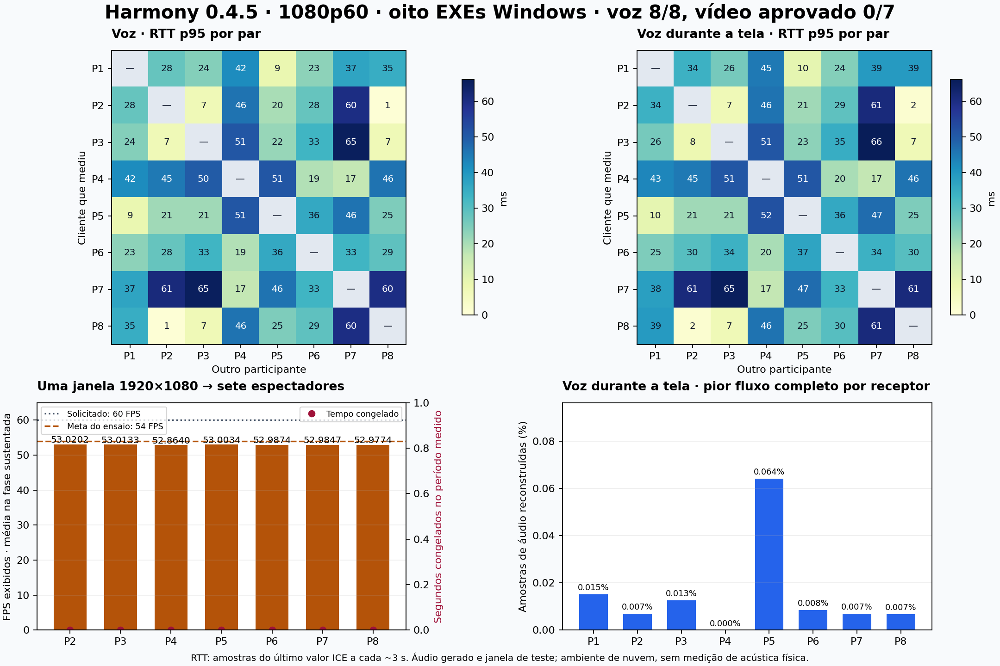
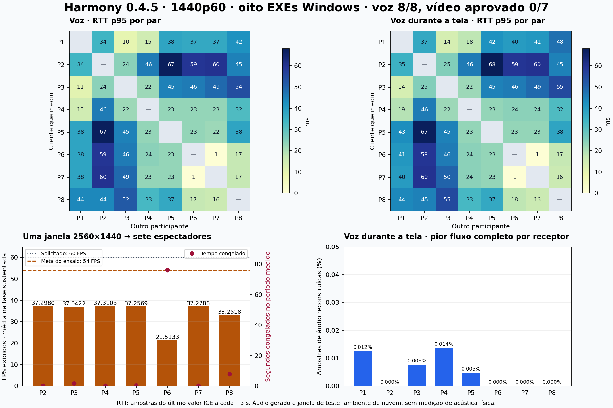
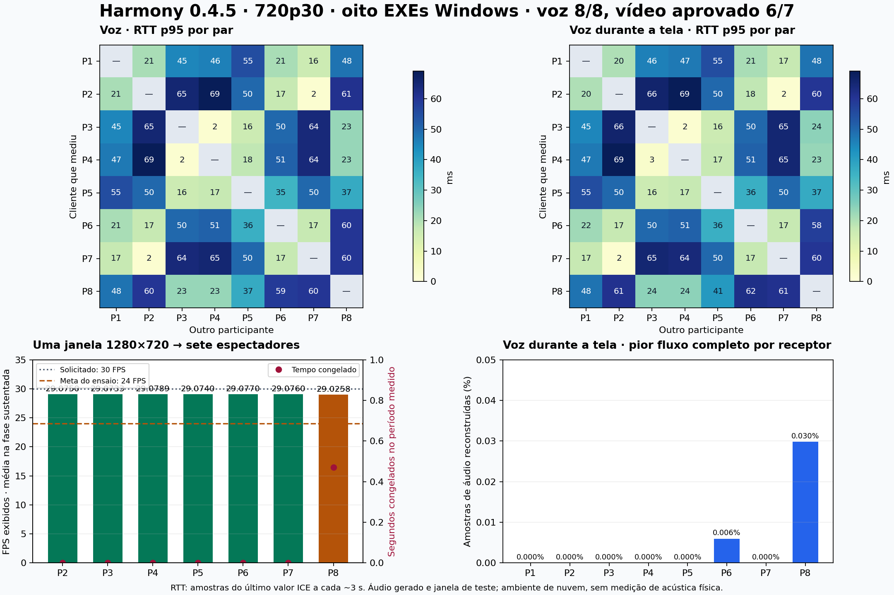

# Harmony 0.4.5 — regressão de cadência medida no Windows

**Os perfis 1080p60 e 1440p60 reprovaram nos oito EXEs. A candidata não está no canal automático.** As medidas abaixo preservam resolução, duração, congelamentos e os mínimos de 54 quadros/s, 54 conteúdos distintos/s e 54 FPS exibidos. Não são uma aprovação de 60 FPS.

| Medida durante voz e tela | 1080p60 solicitado | 1440p60 solicitado |
|---|---:|---:|
| Execução | [43830456246](https://github.com/BersaneV/Harmony/actions/runs/43830456246) | [43830471751](https://github.com/BersaneV/Harmony/actions/runs/43830471751) |
| Resultado | FAIL | FAIL |
| Resolução nos sete receptores | 1920×1080 | 2560×1440 |
| FPS médios exibidos | 52,8640–53,0202 | 21,5133–37,3103 |
| Fonte: quadros/s / conteúdos distintos/s | 53,0971 / 50,3080 | 37,3956 / 36,8962 |
| Congelamentos | Zero nos sete | Nos sete; pior P6: 35 eventos/76,239 s |
| Voz nas duas fases | PASS 8/8, 56 caminhos | PASS 8/8, 56 caminhos |
| RTT de voz mediano / p95 / máximo com tela | 32 / 60 / 67 ms | 36 / 60 / 69 ms |
| Payload do único envio de tela | 2,5557 Mb/s | 2,4851 Mb/s |
| CPU da VM publicadora inteira | 56,75% de quatro cores | 88,55% de quatro cores |

[Dados 1080p](evidence/exe-wan-0.4.5-1080p60-20261116.json) · [Dados 1440p](evidence/exe-wan-0.4.5-1440p60-20261116.json). As duas rodadas confirmaram oito VMs Windows standard públicas, oito egressos HTTPS e oito endereços públicos UDP selecionados distintos, além dos 28 pares de certificados inversos. Cada fase teve 30 segundos de acomodação e pelo menos 180 segundos medidos. A voz permanece P2P; a tela utiliza o SFU opcional existente.

## Resultado e fronteiras da análise

A 0.4.4 havia aprovado 1080p pelos critérios do ensaio e entregue 53,8144–53,9543 FPS em 1440p, ainda reprovado. A 0.4.5 ficou abaixo desses resultados nas duas resoluções. As VMs são diferentes; a comparação não isola causalmente a participação de cada mudança. [Resultados 0.4.4 preservados](EXE-WAN-0.4.4.md).

A inspeção do produtor 0.4.5 identifica uma barreira concreta: a reserva do próximo envio aguarda o instante real do envio anterior mais um período, mas a cópia para o SharedBuffer só ocorre depois dessa reserva. Portanto, o custo da cópia e do agendamento da UI ainda se soma ao intervalo de envio. O prefetch no Vec não remove essa barreira. Uma correção posterior está sendo preparada para antecipar a cópia e manter separado o limite de envio; não faz parte deste binário.

A CPU observada inclui Windows, fixture, app, observador e encoder. Ela não é atribuição isolada ao encoder ou à captura. Em 1440p, P6 também registrou 8.431 pacotes perdidos, razão de 14,82%, e P8 registrou 331, razão de 0,633%. Perda RTP e cadência local são observações distintas: não há prova de que corrigir a captura resolva a perda de um receptor. Os demais congelamentos não foram omitidos, mesmo quando não havia perda RTP acumulada no fluxo completo.

O primeiro probe 1080p já havia falhado com 53,5973 quadros/s e 51,7974 distintos/s; o de 1440p, com 47,1910 e 43,8917. [Probe 1080p](https://github.com/BersaneV/Harmony/actions/runs/43829979994) · [Probe 1440p](https://github.com/BersaneV/Harmony/actions/runs/43829998080). Os ensaios completos foram mantidos e suas falhas não substituem nem apagam as falhas dos probes.

O primeiro [probe 720p](https://github.com/BersaneV/Harmony/actions/runs/43829964650) terminou em timeout CDP antes da medição. A [repetição com trace passivo](https://github.com/BersaneV/Harmony/actions/runs/43833178180), no mesmo EXE publicado, passou em 1280×720 e 29,2941 FPS, com pixels e todos os tamanhos amostrados na resolução integral. Não houve wrapper GDM, alteração do produto ou redução dos critérios. A repetição confirma aquele resultado; não isola a causa do timeout anterior nem aprova sozinha capacidade com oito participantes.

A [regressão completa 720p30](https://github.com/BersaneV/Harmony/actions/runs/43833805045), capturada pelo navegador/GDM a partir da janela Windows própria, também reprovou por congelamento: sete receptores em 1280×720 e 29,0258–29,0789 FPS, voz 8/8 nas duas fases, porém P8 teve dois eventos que somaram 0,471 s, com três pacotes perdidos e quatro NACKs. Os outros seis não congelaram. [Dados 720p](evidence/exe-wan-0.4.5-720p30-20261116.json). O primeiro problema de resolução ficou resolvido nessa rodada; zero congelamentos permanece um critério não atendido.

Uma [observação posterior no mesmo pacote](https://github.com/BersaneV/Harmony/actions/runs/43836305462) confirmou que o Edge/WebView 131.0.2903.86 expõe os setters `jitterBufferTarget` e `playoutDelayHint`. A consulta leu somente os descritores do protótipo, sem invocar getters ou setters de mídia. Ela não comprova a aplicação de buffer no produto nem explica sozinha as pausas.

## Integridade e escopo

Produto/tag: `0833b1a38d607c563c62c9132fe7575306300ffb`; harness das duas matrizes: `978fa30d49048c3d3bad90655d886d7e03384c47`. [CI completo e assinado](https://github.com/BersaneV/Harmony/actions/runs/43824958288), instalação/remoção Windows e 17 verificações do updater, incluindo assinatura, passaram. Isso comprova o pacote e seus controles, sem aprovar desempenho. [Prova do pacote](evidence/package-0.4.5-20261116.json).

Instalador: 4.130.866 bytes, SHA-256 `d9d753d3294290b53f889cc8d0504a7adb6518c9e31a9c5fea533874018a28d7`. EXE instalado: 15.442.432 bytes, SHA-256 `cbfe32adc88f051e8c5469c484d49dc9fb3539d3c15e9b4656464f0cbc242bcf`. A assinatura é do updater Tauri, não Authenticode. [Candidata pública com falhas registradas](https://github.com/BersaneV/Harmony/releases/tag/v0.4.5).

As exportações foram construídas exclusivamente dos logs completos da API dos oito jobs, com índices e amostras únicos, um relatório e uma attestation por cliente. Seus hashes e contagens estão na proveniência dos JSONs. Os dados usam mídia gerada; não aprovam acústica/MOS, GPU física, redes residenciais/5G, NAT restritivo, jogos de alto movimento ou operação prolongada.

Backend e frontend Web hospedados continuam na 0.4.3, o canal automático na 0.4.2 e a alocação gratuita existente foi mantida. Não houve contratação, cartão ou upgrade. A captura e a execução das chamadas não dependem do Mac.
