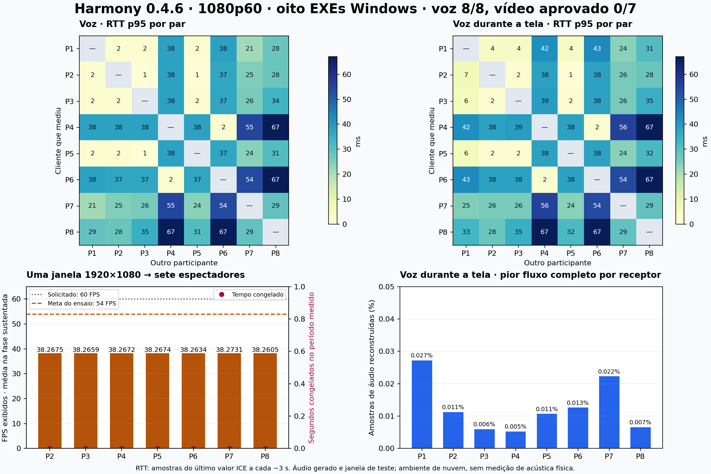
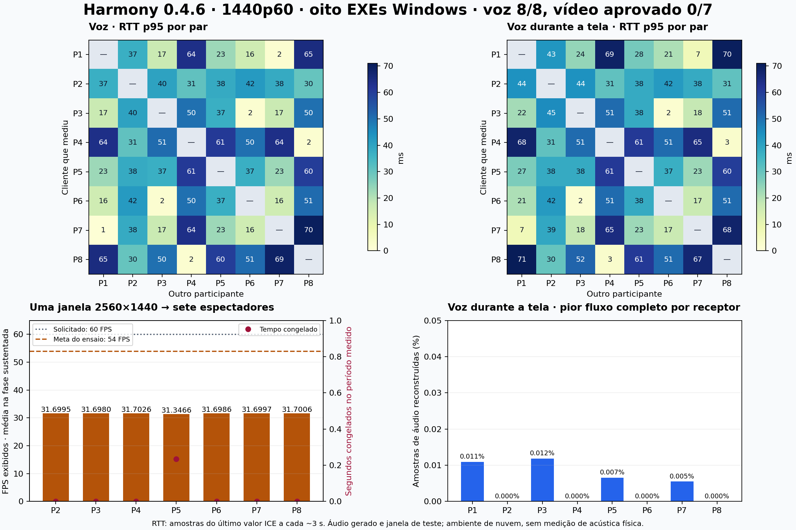

# Harmony 0.4.6 — captura, buffer e limites medidos

**1080p60 e 1440p60 reprovaram nas chamadas com oito EXEs.** A voz passou nos oito clientes, mas a captura não sustentou os mínimos do ensaio. A candidata permanece fora do canal automático. Resolução integral, duração, 54 quadros/s de fonte e conteúdo distinto, 54 FPS exibidos e zero congelamentos continuam sendo os critérios originais.

| Durante voz e tela | 1080p60 solicitado | 1440p60 solicitado |
|---|---:|---:|
| Execução | [43850083190](https://github.com/BersaneV/Harmony/actions/runs/43850083190) | [43850088773](https://github.com/BersaneV/Harmony/actions/runs/43850088773) |
| Resultado | FAIL | FAIL |
| Resolução nos sete receptores | 1920×1080 | 2560×1440 |
| FPS médios exibidos | 38,2605–38,2731 | 31,3466–31,7026 |
| Fonte: quadros/s / conteúdos distintos/s | 38,2575 / 37,6108 | 31,6937 / 31,4304 |
| Congelamentos | Zero nos sete | P5: um evento de 0,235 s; demais seis: zero |
| Voz nas duas fases | PASS 8/8, 56 caminhos | PASS 8/8, 56 caminhos |
| RTT de voz mediano / p95 / máximo com tela | 31 / 66 / 68 ms | 37 / 66 / 75 ms |
| Payload do único envio de tela | 2,1683 Mb/s | 2,5084 Mb/s |
| CPU da VM publicadora inteira | 88,44% de quatro cores | 91,80% de quatro cores |

[Dados 1080p](evidence/exe-wan-0.4.6-1080p60-20261116.json) · [Dados 1440p](evidence/exe-wan-0.4.6-1440p60-20261116.json). Cada rodada confirmou oito VMs Windows, oito egressos HTTPS e oito endereços públicos UDP selecionados distintos, além dos 28 pares de certificados inversos. Cada fase teve 30 segundos de acomodação e pelo menos 180 segundos medidos. A voz é P2P; a tela usa o SFU opcional existente. Os RTTs da tabela são de voz, não latência total da tela.

## Mudanças presentes e resultado observado

O produtor antecipa a cópia para o SharedBuffer e separa essa cópia da publicação dos metadados. Mantém uma única posse do buffer, ACK por sequência, origem local, cancelamento, limite de memória e watchdog de cinco segundos desde a reserva. A publicação continua limitada pelo período de FPS. Os testes Windows do bridge passaram; a execução real acima demonstra que isso não bastou para atingir o desempenho pedido.

O receptor SDK solicita opcionalmente 240 ms de playout somente para a geração de tela explicitamente sem áudio de sistema. A preferência é removida antes da transição para tela com áudio; voz, câmera e publicações com áudio de sistema conservam o comportamento anterior. APIs ausentes ou que rejeitam a preferência não impedem a mídia nem seu ACK.

O efeito foi observado por deltas reais de `jitterBufferDelay` e `jitterBufferEmittedCount`, com continuidade de `stats_id` e SSRC: médias condicionadas aos quadros emitidos de **219,59–220,48 ms em 1080p** e **215,38–218,37 ms em 1440p**. O alvo medido foi 226,00–227,00 ms em 1080p e 221,61–224,83 ms em 1440p. Isso acrescenta atraso de vídeo em relação aos buffers anteriores próximos de 10–13 ms; não é medição de latência total nem garantia contra qualquer interrupção. Não há prova causal de que a preferência, isoladamente, tenha produzido os resultados de congelamento entre rodadas em VMs diferentes.

O evento do P5/índice 4 ocorreu na última janela registrada de 1440p, aproximadamente 10:52:42,368–45,383 UTC: 34 quadros decodificados contra 96 na janela anterior, jitter final de 48 ms contra 5 ms e buffer efetivo médio de 83,09 ms contra 221,30 ms. O decode médio ficou em 4,15 ms por quadro, ante 4,42 ms; deltas de perda, NACK, PLI, FIR e drops foram zero nessa janela. Outros seis receptores entregaram 97–98 quadros em suas janelas finais sobrepostas, sem freeze. O publicador continuou produzindo. As amostras são de cerca de três segundos, os relógios das VMs não foram calibrados entre si e não há prova da causa final da interrupção.

As rodadas anteriores são preservadas: [0.4.4](EXE-WAN-0.4.4.md) e [0.4.5](EXE-WAN-0.4.5.md). A CPU inclui Windows, fonte gerada, observador, app e encoder; não isola CPU de captura ou codificação. As VMs diferentes impedem atribuir toda variação de desempenho a uma mudança específica de versão.

## Perfil temporário do EXE publicado

Um diagnóstico separado manteve a mesma VM, janela, track e prévia por três fases: controle de 10 s, instrumentação de 10 s e controle restaurado de 10 s. Os wrappers delegaram ao construtor e ao writer originais, preservando argumentos, frames, Promise e erros, e foram restaurados ao final. A instrumentação pode alterar o agendamento e não aprova capacidade. [Dados e proveniência](evidence/exe-native-timing-0.4.6-20261116.json).

| Tempo médio na fase instrumentada | 1080p | 1440p |
|---|---:|---:|
| Construtor BGRX de VideoFrame | 1,497 ms | 2,906 ms |
| Writer: chamada até resolução | 0,118 ms | 0,164 ms |
| ACK observado: POST até loadingFinished | 3,010 ms | 3,508 ms |

Em 1440p, os controles mediram 40,1992 e 40,0948 quadros/s; a fase instrumentada, 40,0964. Em 1080p, os controles mediram 52,7942 e 51,0980; a instrumentada, 49,2714. Todas as fases reprovaram os critérios originais. O writer não apresentou espera dominante nessas prévias isoladas; isso não mede seu comportamento durante encode com sete espectadores nem identifica os custos de readback, cópia e filas nativas restantes.

## Regressão 720p: timeout anterior à transmissão

A [rodada 43851509762](https://github.com/BersaneV/Harmony/actions/runs/43851509762) passou a voz nos oito clientes, com 28 pares e 56 caminhos medidos, RTT 34/66/69 ms. O publicador terminou em timeout CDP antes de concluir a seleção da captura pelo navegador; os demais aguardaram a publicação que não ocorreu. A janela física de 1280×720 continuava ativa. Não houve amostras de tela, portanto FPS, congelamentos e capacidade dessa etapa permanecem **NOT_RUN**, com resultado geral FAIL. [Dados do timeout preservados](evidence/exe-wan-0.4.6-720p30-timeout-20261116.json).

O resumo de rede da exportação reprova a ausência das rotas de tela; isso não apaga os caminhos UDP da fase de voz concluída. O [probe isolado anterior](https://github.com/BersaneV/Harmony/actions/runs/43847588669) passou em 1280×720 e 29,1974 FPS no mesmo pacote. Essa diferença ainda não isola a causa do timeout e não substitui a regressão completa.

## Integridade e alcance

Produto/tag: `420346ede0446d6964d7c1223331aa01670cacba`; harness das três matrizes: `339b58d6cde062ddf4ef524daa092b8532d2d88c`. O [CI completo](https://github.com/BersaneV/Harmony/actions/runs/43840922487), instalação/remoção Windows e 17 verificações do updater, incluindo assinatura, passaram. [Prova do pacote](evidence/package-0.4.6-20261116.json). Esses gates validam o pacote e seus controles, sem aprovar FPS ou recuperação de mídia.

Instalador: 4.133.140 bytes, SHA-256 `88728ac10107d7d9ca35715af20b96b57c90006157c4082b29a63a42853b0fdd`. EXE instalado: 15.421.952 bytes, SHA-256 `d5527e165f3fab08acea0214e76428f12c0c3849fc851206b650df30a10d6876`. A assinatura é do updater Tauri, não Authenticode. [Candidata pública](https://github.com/BersaneV/Harmony/releases/tag/v0.4.6).

Os JSONs derivam dos oito logs completos de cada rodada pela API dos jobs, com índices e amostras únicos e uma attestation e um relatório por cliente. Seus hashes e contagens estão na proveniência. Nenhum rollup truncado foi usado como base. Mídia gerada em VMs não aprova acústica/MOS, GPU física, redes residenciais/5G, NAT restritivo, jogos ou operação prolongada.

Backend e Web hospedados permanecem na 0.4.3; updater, na 0.4.2. A alocação externa gratuita existente foi mantida, sem cartão, contratação ou upgrade. As chamadas e a hospedagem não dependem do Mac. A meta de 1080p60/1440p60 com oito participantes continua pendente.
