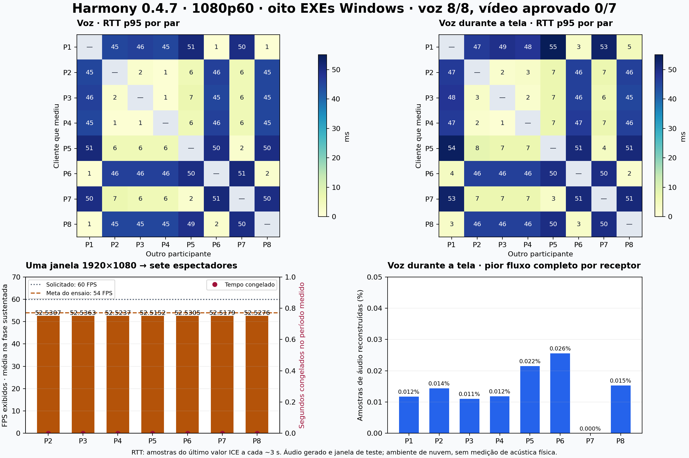
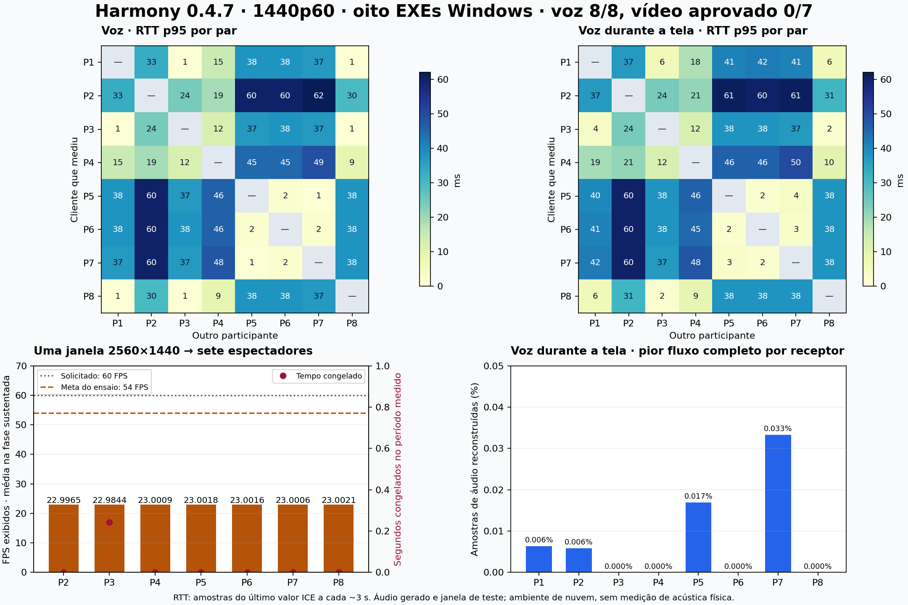
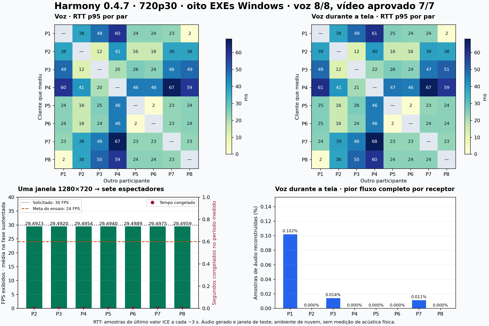

# Harmony 0.4.7 — captura Windows e limites de codificação

**720p30 passou com oito EXEs. 1080p60 e 1440p60 continuam reprovados.** A voz passou nos oito clientes nas três rodadas; resolução integral e conexão não bastam para aprovar 60 FPS. A candidata é manual e permanece fora do canal automático.

| Durante voz e tela | 1080p60 solicitado | 1440p60 solicitado | Regressão 720p30 |
|---|---:|---:|---:|
| Execução | [43876496094](https://github.com/BersaneV/Harmony/actions/runs/43876496094) | [43876506573](https://github.com/BersaneV/Harmony/actions/runs/43876506573) | [43878139406](https://github.com/BersaneV/Harmony/actions/runs/43878139406) |
| Resultado | FAIL | FAIL | PASS |
| Resolução nos sete espectadores | 1920×1080 | 2560×1440 | 1280×720 |
| FPS médios exibidos | 52,5152–52,5363 | 22,9844–23,0021 | 29,4920–29,4989 |
| Fonte nativa: quadros/s / conteúdo distinto/s | 52,5186 / 49,1640 | 41,2630 / 39,8502 | 29,5001 / 28,2398 |
| Congelamentos | Zero nos sete | P3/índice 2: um evento de 0,242 s; demais seis: zero | Zero nos sete |
| Voz nas duas fases | PASS 8/8, 56 caminhos | PASS 8/8, 56 caminhos | PASS 8/8, 56 caminhos |
| RTT de voz mediano / p95 / máximo com tela | 45 / 51 / 58 ms | 37 / 60 / 70 ms | 24 / 60 / 68 ms |
| Payload do único envio de tela | 2,4990 Mb/s | 3,2315 Mb/s | 1,2090 Mb/s |
| CPU da VM publicadora inteira | 72,79% de quatro processadores lógicos | 81,87% de quatro processadores lógicos | 34,28% de quatro processadores lógicos |

Cada rodada confirmou oito VMs Windows, oito egressos HTTPS e oito endereços públicos UDP selecionados distintos, além de 28 pares de certificados inversos. Cada fase teve 30 s de acomodação e pelo menos 180 s medidos. A voz é P2P; a tela usa o SFU opcional existente. Os RTTs da tabela são de voz, não latência total da tela.

[Dados 1080p](evidence/exe-wan-0.4.7-1080p60-20261116.json) · [Dados 1440p](evidence/exe-wan-0.4.7-1440p60-20261116.json) · [Dados 720p](evidence/exe-wan-0.4.7-720p30-20261116.json).

## Mudanças presentes

O produtor publica quadros por prazos nominais, evitando somar o custo de cada callback ao prazo seguinte. Mantém uma única posse de SharedBuffer, ACK por sequência, epoch do perfil, descarte de quadros antigos, cancelamento, origem e watchdog de cinco segundos desde a reserva. Os contadores continuam medindo envios reais. A captura ainda usa início real mais período; o intervalo entre callbacks de publicação pode variar.

No Windows, o modo automático usa a captura nativa para FPS explícitos 15/24/30/60 quando o áudio da tela está desligado. A voz dos microfones permanece ativa. FPS Automático 0, navegador escolhido explicitamente, áudio da tela ligado e indisponibilidade nativa conservam a captura do navegador. Os defaults de áudio não mudaram. Cancelar não inicia fallback automático.

Os três ensaios usaram WGC com áudio da tela desligado. A regressão 720p completou a seleção e transmissão sem o timeout anterior. Isso valida esse caminho nativo; não é correção universal de getDisplayMedia nem aprovação de áudio de sistema em 60 FPS. As falhas anteriores estão preservadas no [relatório 0.4.6](EXE-WAN-0.4.6.md).

## Captura e encoder são medidas diferentes

Em 1080p, o clone da fonte contou 9.550 quadros em 181,8404 s. Nas 61 amostras steady do único sender SFU ativo, os deltas de frames do media-source e framesEncoded foram ambos 9.549. O quociente de tempo de encode por quadro foi 12,4793 ms.

Em 1440p, a fonte nativa contou 7.506 quadros em 181,9064 s, mas o media-source WebRTC avançou 4.184 e o encoder, 4.185: aproximadamente 23 FPS na saída. O quociente de encode foi 27,0117 ms por quadro. O próprio sender reportou limitação de CPU nas 61 amostras: sua duração CPU avançou 181,908 s; bandwidth ficou zero. Os parâmetros mantiveram 60 FPS, teto de 16 Mb/s, maintain-resolution e contentHint motion. A proteção de CPU foi mantida.

Essas observações não atribuem toda a CPU ao encoder, nem demonstram GPU ou quantidade de threads. A CPU da tabela inclui Windows, fonte gerada, app e observador. As VMs das rodadas diferem, impedindo atribuir toda variação entre versões a uma única alteração. As sete linhas mesh de tela inativas foram excluídas da análise de codificação. O content_type opcional esteve ausente nas 61 amostras de cada perfil de 60 FPS e permanece NOT_VERIFIED.

## Buffer e congelamento

Os contadores dos sete receptores, com continuidade de stats_id e SSRC, confirmaram buffer efetivo médio de 219,60–220,52 ms em 1080p e 217,87–220,04 ms em 1440p. Os targets medidos foram 226–227 ms e 223,54–224,46 ms, respectivamente. O hint de 240 ms continua restrito à tela explicitamente sem áudio de sistema; não altera a voz.

O evento de P3/índice 2 ocorreu no intervalo aproximadamente 13:47:22,811–25,824 UTC: 69 quadros decodificados, delta de decode de 0,437018 s, jitter de 20→29 ms e buffer efetivo médio de 135,92 ms. Deltas de perda, NACK, PLI, FIR e drops foram zero. Isso não estabelece a causa final do freeze. As amostras têm cerca de três segundos e os relógios das VMs não foram calibrados entre si. Buffer e RTT não são medições de latência total.

## Integridade e alcance

Produto/tag: e1b6f4470d0c17cf95265b07761760067898f0d9. Harness 1080p/1440p: 4f9774111e2c9753ec11b89530441d335e534bd2. Harness 720p: 1798ac0bcd12947f73fb7ede8e21b41826ff327d, que acrescentou somente documentação histórica; os arquivos de QA são idênticos. O [CI completo](https://github.com/BersaneV/Harmony/actions/runs/43868917051), instalação/remoção Windows e 17 verificações do updater passaram. [Prova do pacote](evidence/package-0.4.7-20261116.json).

Instalador: 4.137.120 bytes, SHA-256 8bb3660b2046d2ec610833d71b61d2397dfe9041daa1f2bb8fe1a1c88f3a5f0a. EXE instalado: 15.421.952 bytes, SHA-256 71ba4f59373953f35a35cb917c691cb050d23179e847a046d57ecf618b5cd55d. A assinatura é do updater Tauri, não Authenticode. [Candidata pública](https://github.com/BersaneV/Harmony/releases/tag/v0.4.7).

Cada JSON preserva os resultados originais e acrescenta proveniência dos oito logs completos pela API dos jobs: índices únicos, oito attestations, oito relatórios e 1.136 amostras únicas por rodada. Nenhum rollup truncado ou arredondamento foi usado para aprovar os gates. Os perfis de 60 FPS continuam exigindo pelo menos 54 FPS bruto, distinto e exibido, resolução integral e zero freezes; 720p mantém 24 FPS mínimos.

Mídia gerada em VMs não aprova acústica/MOS, GPU física, redes residenciais/5G, jogos ou operação prolongada. Backend e Web hospedados permanecem na 0.4.3 e o canal automático, na 0.4.2. A alocação gratuita existente foi mantida, sem cartão, contratação ou upgrade. A meta de 1080p60/1440p60 com oito participantes continua pendente.
