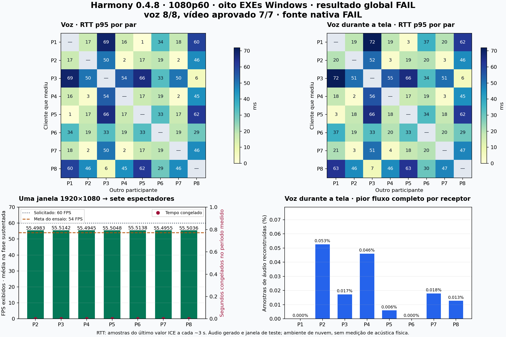
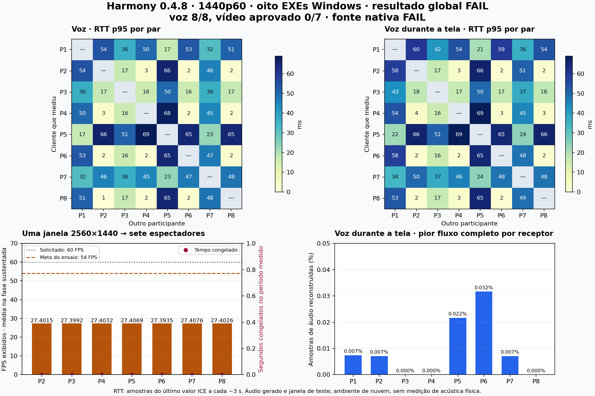
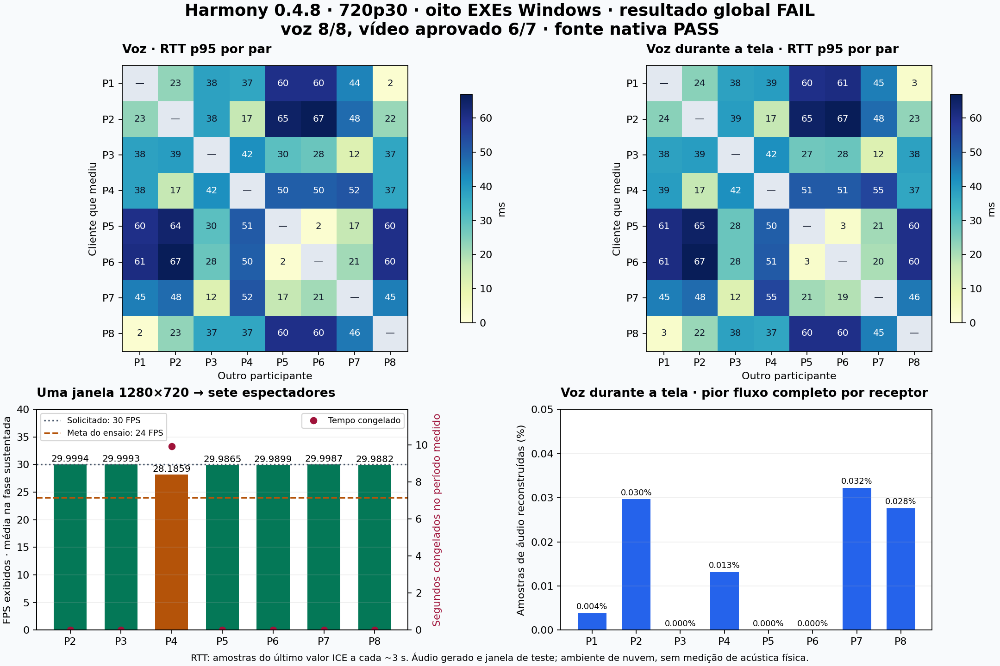
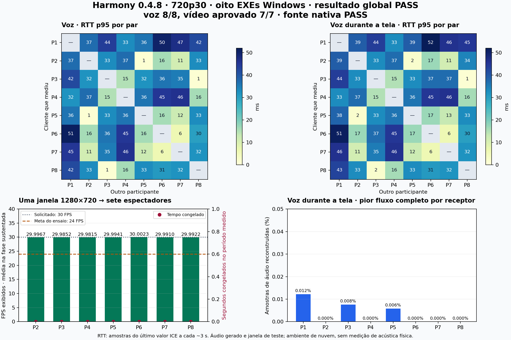

# Harmony 0.4.8 — cadência, codificação e testes com oito EXEs

**A meta de 1080p60 e 1440p60 continua reprovada.** Em 1080p, os sete receptores passaram, mas o conteúdo distinto da fonte ficou abaixo do mínimo. Em 1440p, fonte e reprodução ficaram abaixo da meta. A primeira regressão 720p30 também reprovou por congelamentos no P4; uma repetição do mesmo pacote passou, sem substituir esse FAIL. A voz passou nos oito clientes nas três rodadas.

| Durante voz e tela                            |                                                          1080p60 solicitado |                                                          1440p60 solicitado |                                                     720p30, primeira rodada |
| --------------------------------------------- | --------------------------------------------------------------------------: | --------------------------------------------------------------------------: | --------------------------------------------------------------------------: |
| Execução                                      | [43899420135](https://github.com/BersaneV/Harmony/actions/runs/43899420135) | [43899455989](https://github.com/BersaneV/Harmony/actions/runs/43899455989) | [43901364335](https://github.com/BersaneV/Harmony/actions/runs/43901364335) |
| Resultado global                              |                                                                        FAIL |                                                                        FAIL |                                                                        FAIL |
| Resolução nos sete espectadores               |                                                                   1920×1080 |                                                                   2560×1440 |                                                                    1280×720 |
| FPS médios exibidos                           |                                                             55,4945–55,5142 |                                                             27,3935–27,4076 |                                                             28,1859–29,9994 |
| Fonte nativa: quadros/s / conteúdo distinto/s |                                                           55,5300 / 51,5204 |                                                           27,4001 / 27,3507 |                                                           30,0010 / 29,8522 |
| Congelamentos                                 |                                                               Zero nos sete |                                                               Zero nos sete |                         P4/índice 3: 10 eventos, 9,932 s; demais seis: zero |
| Voz nas duas fases                            |                                                       PASS 8/8, 56 caminhos |                                                       PASS 8/8, 56 caminhos |                                                       PASS 8/8, 56 caminhos |
| RTT de voz mediano / p95 / máximo com tela    |                                                             28 / 65 / 74 ms |                                                             36 / 66 / 77 ms |                                                             38 / 64 / 68 ms |
| Payload do único envio de tela                |                                                                 1,0989 Mb/s |                                                                 0,8971 Mb/s |                                                                 0,4790 Mb/s |
| CPU da VM publicadora inteira                 |                                      69,44% de quatro processadores lógicos |                                      84,16% de quatro processadores lógicos |                                      28,50% de quatro processadores lógicos |

Cada rodada confirmou oito VMs, oito egressos HTTPS e oito endereços públicos UDP selecionados distintos, 28 pares de certificados inversos e 56 fluxos direcionados de microfone. Cada fase teve 30 s de acomodação e pelo menos 180 s medidos. A voz é P2P e a tela usa o SFU opcional existente. Os RTTs da tabela são de voz, não latência total da tela.

[Dados 1080p](evidence/exe-wan-0.4.8-1080p60-20261116.json) · [Dados 1440p](evidence/exe-wan-0.4.8-1440p60-20261116.json) · [Dados 720p, primeira rodada](evidence/exe-wan-0.4.8-720p30-20261116.json).

## Alterações do aplicativo

A captura usa prazos nominais por revisão de perfil; polls sem quadro não consomem o período e atrasos não acumulam uma fila de trabalho vencido. A publicação nominal introduzida na 0.4.7 permanece. Intervalos reais entre capturas podem ser menores que o período após uma variação de espera; timestamps, FPS efetivos e contadores continuam reais.

O pipeline mantém um quadro preparado, uma posse de SharedBuffer, ACK por sequência, epoch/ABA, descarte de quadros antigos, cancelamento, origem e watchdog de cinco segundos desde a reserva. A proteção de CPU do encoder permanece ligada.

A opção local “Otimizar desempenho da tela” começa ligada no caminho nativo e aplica a indicação de conteúdo detail ao generator. Desligada, conserva o hint literal da opção Conteúdo. A escolha vale para a próxima captura, sem alterar FPS, bitrate ou uma track existente. Pode mudar a prioridade entre movimento e detalhes. Captura do navegador e câmera mantêm suas políticas.

O caminho nativo segue restrito a FPS explícitos 15/24/30/60, método automático e áudio da tela desligado. Os microfones da chamada permanecem ativos. Áudio da tela, navegador explícito, FPS Automático 0 e indisponibilidade nativa conservam a captura do navegador. Estes ensaios não aprovam áudio de sistema em 60 FPS nem uma correção universal de getDisplayMedia.

## Fonte e encoder

Em 1080p, o clone do generator contou 10.110 quadros brutos e 9.380 distintos em 182,0638 s: 730 marcadores consecutivos iguais já aparecem antes do encoder. As seis janelas de aproximadamente 30 s tiveram conteúdo distinto abaixo de 54 FPS. O media-source SDK avançou 10.108 quadros; o encoder, 10.107. O quociente de tempo de encode por quadro foi 9,2747 ms. Os dados atuais não localizam a repetição entre WGC e ponte nativa.

Em 1440p, o clone contou 4.993 quadros brutos e 4.984 distintos em 182,2257 s. O media-source SDK avançou 4.993 e o encoder, 4.994. O quociente de encode foi 20,4768 ms por quadro. Em 720p, fonte e conteúdo distinto passaram; o encoder avançou 5.448 quadros, com quociente de 5,2539 ms.

Nos três perfis, as 61 amostras sustentadas do sender SFU ativo reportaram contentHint detail, content_type screenshare e qualityLimitationReason none. As durações de limitação CPU e bandwidth não avançaram. Isso preserva o que o WebRTC reportou; não demonstra ausência de pressão de CPU no restante do aplicativo. As sete linhas mesh de tela inativas foram excluídas dessa análise. VP8, encoding único, maintain-resolution e os tetos solicitados de FPS/bitrate permaneceram.

CPU da VM inclui Windows, fixture, app, codificação e observação. As VMs das versões e perfis diferem; a comparação com a 0.4.7 não é um controle na mesma máquina e não atribui toda variação a uma alteração. Os [diagnósticos controlados anteriores](EXE-DIAGNOSTICS-0.4.7.md) têm seus próprios limites. Os novos diagnósticos de WGC e da ponte sob carga ainda precisam ser executados.

## Congelamentos na primeira rodada 720p

O P4 recebeu 11.794 pacotes de tela e registrou perda de 269, razão de 2,23%, além de 416 NACKs, dois PLIs e dez freezes, somando 9,932 s. O RTP registrou 214 framesDropped; a qualidade de reprodução do elemento de vídeo registrou 106 dropped frames. São contadores distintos e não foram somados.

As perdas e freezes se concentraram aproximadamente entre 75,38 e 93,48 s da janela sustentada. Nesse trecho, o RTT da conexão SFU variou nos pontos amostrados de 180 a 366 ms. Há uma janela de cerca de três segundos sem avanço de framesDecoded. Essas observações relacionam a falha à entrega/recuperação desse fluxo, mas não estabelecem causa final de rede, servidor ou aplicativo. O áudio P2P desse cliente passou.

Os demais seis espectadores não tiveram freezes, e a fonte continuou em 1280×720 com aproximadamente 30 quadros brutos e 29,85 distintos por segundo. A repetição [43905363257](https://github.com/BersaneV/Harmony/actions/runs/43905363257) usou o mesmo EXE e configuração em novas VMs e passou, sem apagar ou converter a primeira rodada em PASS.

## Repetição 720p30 com o mesmo pacote

A rodada 43905363257 confirmou sete espectadores em 1280×720, 29,9815–30,0023 FPS exibidos e zero freezes. A fonte contou 5.454 quadros brutos e 5.146 distintos em 181,8145 s: 29,9976 e 28,3036 por segundo, ambos acima do gate de 24 FPS. Rede, 28 pares, 56 fluxos de microfone e voz nos oito clientes passaram nas duas fases.

Durante a tela, o RTT de voz foi 32/46/52 ms (mediana/p95/máximo), com CPU da VM publicadora inteira de 43,73% de quatro processadores lógicos. Esta rodada usa outras VMs e rotas; não é uma correção de código nem prova da causa final dos congelamentos anteriores. Os resultados 720p da 0.4.8 incluem uma rodada FAIL e uma PASS.

[Dados da repetição 720p](evidence/exe-wan-0.4.8-720p30-repeat-20261116.json).

## Integridade e alcance

Produto/tag: 976feabc142767f9175cf57ccac8ab49c4d76109. Harness 1080p/1440p: cc62ef3fe2ba85f946723034619a481a941faf18. Harness 720p: 922ce347096db1dfaca6926f7c10bebf40ef24d4, que acrescentou apenas documentação; os arquivos QA permanecem idênticos. O [CI completo](https://github.com/BersaneV/Harmony/actions/runs/43891249871), instalação/remoção Windows e 17 verificações do updater passaram. [Prova do pacote](evidence/package-0.4.8-public-proof.json).

Instalador: 4.135.508 bytes, SHA-256 ab669de80c51e729b0901d01742969e7d43e241a0f3c9254d8b7b3bac0c940bc. EXE instalado: 15.422.464 bytes, SHA-256 96c9790236c38a18c759e2fac151b92257aaa6b487db9359d4ef79d8bd083f5b. Assinatura do updater Tauri, sem Authenticode. [Candidata manual](https://github.com/BersaneV/Harmony/releases/tag/v0.4.8).

Os JSONs preservam métricas e resultados originais e acrescentam a proveniência dos oito logs completos pela API dos jobs: oito attestations, oito relatórios e 1.136 amostras únicas por rodada. Não houve aprovação por rollup truncado ou arredondamento. Os perfis de 60 FPS continuam exigindo pelo menos 54 FPS brutos, distintos e exibidos, resolução integral e zero freezes; 720p mantém 24 FPS mínimos e zero freezes.

Mídia gerada em VMs não aprova acústica/MOS, GPU física, redes residenciais/5G, jogos, oito telas simultâneas ou operação prolongada. Os probes isolados passaram em 720p30 e 1080p60 e reprovaram em 1440p60; o probe 1440p no Windows 2025 também reprovou. Eles não substituem as chamadas completas acima.

Backend e Web hospedados continuam na 0.4.3 e o canal automático, na 0.4.2. A alocação gratuita existente foi mantida, sem cartão, contratação, upgrade ou dependência do Mac. A meta de alta resolução com oito participantes permanece pendente.
