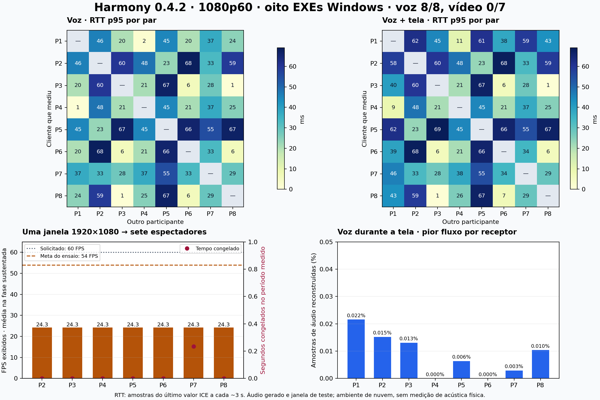
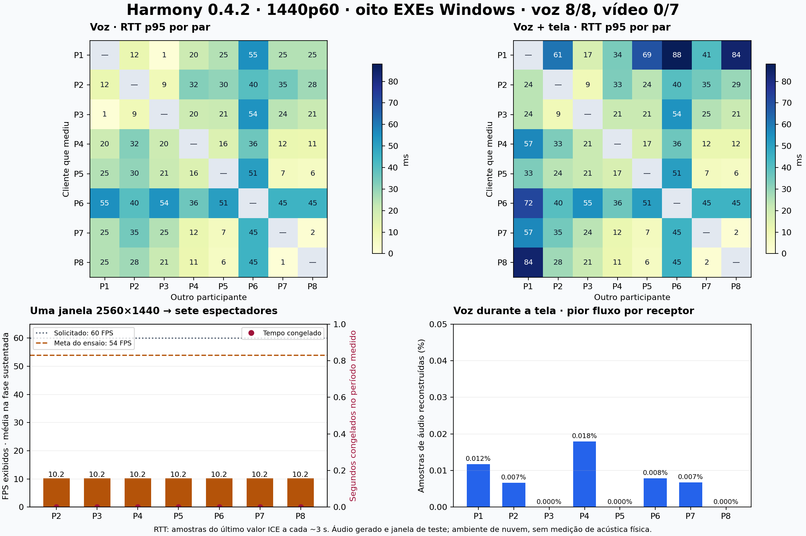

# Harmony — oito EXEs em 1080p60 e 1440p60 com voz

Este documento preserva a campanha do EXE 0.4.2. A otimização posterior da captura e da codificação, com resultados próprios, está em [EXE-WAN-0.4.3.md](EXE-WAN-0.4.3.md). As medições abaixo não foram substituídas.

**Resultado: FAIL nos dois perfis de 60 FPS. Voz aprovada em 8/8 nas duas rodadas finais; vídeo aprovado em 0/7 pelo critério de FPS.** A resolução integral foi preservada, mas o desempenho solicitado não foi atingido. As correções desta campanha são da bancada de teste; o produto distribuído continua na 0.4.2. A meta de 60 FPS permanece pendente.

| Rodada final com voz e tela | 1080p60 solicitado | 1440p60 solicitado |
|---|---:|---:|
| Execução | [43691647486](https://github.com/BersaneV/Harmony/actions/runs/43691647486) | [43691505222](https://github.com/BersaneV/Harmony/actions/runs/43691505222) |
| Resolução em todas as amostras sustentadas | 1920×1080 | 2560×1440 |
| FPS médios exibidos nos sete receptores | 24,2548–24,2820 | 10,1994–10,2076 |
| Congelamentos adicionais | 1 em P7, 0,234 s; demais zero | Zero nos sete |
| Voz durante a tela | PASS 8/8 | PASS 8/8 |
| RTT ICE mediano / p95 / máximo | 33 / 67 / 79 ms | 24 / 54 / 156 ms |
| Pior reconstrução de amostras de voz | 0,02155% | 0,01795% |
| Pior p95 de jitter de voz | 19 ms | 25 ms |
| FPS da fonte, mediana sob a chamada | 25 | 10 |
| Payload de vídeo enviado, soma dos sete fluxos | 6,637 Mb/s | 8,445 Mb/s |
| Teto configurado por espectador | 8 Mb/s | 16 Mb/s |

Zero congelamentos em 1440p não significa fluidez de 60 FPS: houve entrega contínua em aproximadamente 10 FPS. RTT ICE é o último valor de ida e volta reportado pelas conexões; não mede atraso completo de fala ou captura até a exibição.

[Dados completos 1080p](evidence/exe-wan-1080p60-20261115.json) · [Dados completos 1440p](evidence/exe-wan-1440p60-20261115.json). São dados de teste sanitizados, sem senhas, tokens, IPs ou UUIDs brutos. Os identificadores de rede e de VM são HMACs.

## Sete recepções da mesma tela

P1 transmite e recebe sete microfones; P2–P8 recebem a tela e sete microfones cada um. As duas rodadas confirmaram oito VMs e oito egressos públicos TCP/UDP distintos, 28 pares de certificados nativos inversos e 56 recepções direcionais de microfone por fase. Todas as rotas efetivas de mídia são UDP srflx ↔ srflx, sem TURN ou SFU.

| Receptor | 1080p: FPS exibidos | 1080p: congelamentos / duração | 1440p: FPS exibidos | 1440p: congelamentos / duração |
|---|---:|---:|---:|---:|
| P2 | 24,2820 | 0 / 0,000 s | 10,2072 | 0 / 0,000 s |
| P3 | 24,2752 | 0 / 0,000 s | 10,1998 | 0 / 0,000 s |
| P4 | 24,2793 | 0 / 0,000 s | 10,2076 | 0 / 0,000 s |
| P5 | 24,2778 | 0 / 0,000 s | 10,2034 | 0 / 0,000 s |
| P6 | 24,2768 | 0 / 0,000 s | 10,2026 | 0 / 0,000 s |
| P7 | 24,2548 | 1 / 0,234 s | 10,1994 | 0 / 0,000 s |
| P8 | 24,2770 | 0 / 0,000 s | 10,2001 | 0 / 0,000 s |

O head do harness das duas rodadas finais é `bb762b59c09553353277fb63f11594c46e838579`. A fonte do produto é a da 0.4.2, empacotada em `9e7a6ee4f083b7c65adad73da5d1fa69d7a80ae2`; `git diff` confirmou ausência de alterações em `apps/desktop` durante esta campanha. Os oito clientes de cada rodada instalaram o mesmo EXE real, sem substituir a engine por código do teste.

Instalador público de **4.061.086 bytes**, SHA-256 `315fef35166b618d00fec3167b4ee7fa10d7935ae7bd3c19b36ba6ff4420f096`; EXE instalado SHA-256 `31559a726a64ae063a3e4b06b3c0fd57c55aae34b0a09fdb8b07c9437de7cb12`. O download público e o feed de atualização foram reconferidos após os ensaios; continuam na 0.4.2.

## Método e critérios preservados

Cada fase usa 30 s fixos de acomodação e pelo menos 180 s adicionais de medição. Primeiro voz; depois voz com uma tela. O áudio é fala gerada por SAPI no Windows, sem câmera ou microfone físico. A tela é uma janela WinForms própria, capturada por `getDisplayMedia` e selecionada por HWND exato. Os controles do EXE escolhem resolução, 60 FPS, bitrate manual e conteúdo de movimento; áudio do sistema desligado. O modo normal apenas observa as APIs e não modifica parâmetros de codificação.

Os perfis ficam numa allowlist imutável. O critério de vídeo exige resolução integral em todas as amostras, média exibida de pelo menos **54 FPS**, zero congelamentos e contadores presentes. O limiar corresponde a 90% do alvo; 30 ou 50 FPS não passam. Configuração de 60 em `getSettings()` não é medição de 60. A aprovação de voz exige sete fluxos por cliente, áudio não reconstruído equivalente a pelo menos 80% do tempo, reconstrução de no máximo 2% e RMS decodificado mínimo de 0,03.

Os sete codificadores usaram **VP8/libvpx**, com `maintain-resolution`, `contentHint=motion`, teto de 60 FPS e escala 1 confirmados nativamente. Não houve fallback H264 indevido para esses perfis. O tempo médio por frame codificado foi 12,05–14,58 ms em 1080p e 29,38–35,16 ms em 1440p. Nas amostras sustentadas do emissor, `qualityLimitationReason` retornou `none`, com deltas de duração zero para `cpu` e `bandwidth`. Esses campos não permitem atribuir a um mecanismo específico de proteção de CPU ou à internet uma causa que não foi isolada.

A captura isolada já ficou abaixo de 54 FPS, antes da rede ou dos sete encoders. Sob a chamada, os FPS da fonte caíram para 25/10. O conjunto é compatível com limitações de captura e processamento por software nesta infraestrutura; a participação exata de cada componente ainda não foi isolada. A medição não demonstra que todo PC Windows terá o mesmo resultado.

## Correções da bancada e falhas históricas

A primeira fonte tinha objetos animados que saíam da área visível do desktop virtual. A troca de resolução do desktop não foi aceita pelo driver. A geometria nativa da janela continuou correta e o frame completo tinha conteúdo colorido, mas isso não comprovava atualização contínua em 60 FPS. Acrescentou-se um marcador que sempre avança dentro da área visível. Um temporizador nativo de alta precisão mantém mais de 100 atualizações/s na calibração, evitando confundir limitação do gerador com limitação do produto.

A contagem direta de frames de `MediaStreamTrackProcessor` foi separada da contagem exibida pela prévia. Foram acrescentadas leituras passivas dos codecs negociados, implementação do encoder e agendamento nativo de captura. A comparação com o runtime atualizado inicialmente falhou antes da captura por falta de CDP; o argumento documentado `--edge-webview-switches` resolveu a instrumentação. Duas tentativas também pararam ao detectar alias de registro duplicado no teste; a escrita redundante foi removida. Esses FAILs permanecem no registro, sem resultados de desempenho inventados.

| Rodada inicial preservada | FPS exibidos | Congelamentos por receptor | Voz |
|---|---:|---:|---:|
| [1080p, 43690200732](https://github.com/BersaneV/Harmony/actions/runs/43690200732) | 16,2918–16,3287 | 64, somando 57,379–57,535 s | PASS 8/8 |
| [1440p, 43690205044](https://github.com/BersaneV/Harmony/actions/runs/43690205044) | 6,8049–6,8113 | 54, somando 54,940–55,067 s | PASS 8/8 |

[Dados iniciais 1080p](evidence/exe-wan-1080p60-initial-20261115.json) · [Dados iniciais 1440p](evidence/exe-wan-1440p60-initial-20261115.json). A repetição teve outras VMs e alterou a fonte de teste, mantendo o mesmo EXE; não é um A/B controlado na mesma máquina nem prova de correção do aplicativo. O run 43691502248 foi cancelado pela fila antes dos clientes e não recebeu resultado de qualidade.

## Alternativas gratuitas de captura verificadas

Nenhuma variante abaixo aprovou uma fonte de alta resolução em pelo menos 54 FPS. As tentativas que não chegaram à captura estão separadas nos [20 registros de diagnóstico](evidence/exe-wan-highres-calibration-20261115.json).

| Condição de calibração | 1080p: FPS exibidos na prévia | 1440p: FPS exibidos na prévia |
|---|---:|---:|
| WebView2 131, GPU desativada pelo teste, fonte inicial | 30,50 | 21,60 |
| WebView2 131, gráficos padrão, fonte inicial | 32,00 | 23,00 |
| WebView2 131, tentativa WGC, fonte inicial | 30,20 | 21,40 |
| Marcador sempre visível, relógio inicial | 48,70 | 48,80 |
| Marcador e relógio nativo preciso, WebView2 131 | Não medido isoladamente nessa variante | 49,90 |
| WebView2 157 atualizado, Windows 2022, fonte corrigida | 40,60 | Não medido nessa variante |
| Windows 2025, WebView2 156, fonte corrigida | 38,69 | 38,39 |

Onde disponível, o contador direto da fonte confirmou taxas equivalentes às da prévia. O runtime 131 usou SwiftShader; 156/157 usaram Microsoft Basic Render Driver, todos caminhos de renderização por software observados. O instalador Evergreen teve assinatura Authenticode válida da Microsoft e versão de runtime 157.0.4341.60 confirmada. Atualizar o runtime não resolveu 60 FPS neste ambiente.

As flags de comparação são de diagnóstico e não foram adicionadas ao produto. A [Microsoft orienta seu uso para testes e diagnóstico](https://learn.microsoft.com/en-us/microsoft-edge/webview2/concepts/webview-features-flags). A [calibração de regressão 720p30](https://github.com/BersaneV/Harmony/actions/runs/43692641745) passou após as alterações da bancada: 1280×720, 29,1968 FPS observados. A aprovação anterior com oito EXEs a 720p30 está em [EXE-WAN-0.4.2.md](EXE-WAN-0.4.2.md).

## Custo, encerramento e pendência

Usaram-se somente runners Windows standard de repositório público, quatro vCPUs e 16 GB, sem artifacts, caches ou runners maiores. O GitHub documenta [uso gratuito e ilimitado desses runners públicos](https://docs.github.com/en/actions/reference/runners/github-hosted-runners#standard-github-hosted-runners-for-public-repositories). Não houve cartão, compra ou alteração da hospedagem. O serviço HTTPS externo continuou saudável em `/health`, com backend 0.4.1 compatível; a execução não dependeu do Mac para hospedar o Harmony.

A meta de **1080p60 e 1440p60 para todos continua PENDENTE**. Falta uma fonte nativa validada a 60 FPS e capacidade de captura/codificação/reprodução suficiente para repetir a prova. Os recursos gratuitos usados aqui não sustentaram o alvo. Não foi identificada e validada uma alteração pequena do aplicativo que resolva esse limite; as fontes do produto e o pacote público foram preservados.

As provas não cobrem GPU física, acústica, redes residenciais/5G, NAT restritivo, jogos de alto movimento, várias telas/câmeras nem operação prolongada. Não há aprovação universal de qualidade. Implementação da bancada, execução e publicação das evidências estão concluídas; a aprovação de desempenho a 60 FPS está aberta.

Todos os jobs terminaram e os clientes saíram das chamadas; o estado público de cada sala final voltou a zero participantes. O segredo temporário `HARMONY_EXE_WAN_SEED` foi removido do GitHub, preservando os dois segredos de assinatura. Nenhum config.toml foi alterado. Correções da bancada e evidências publicadas diretamente na main pessoal, sem PR. Os critérios de 60 FPS continuam reprovados.
