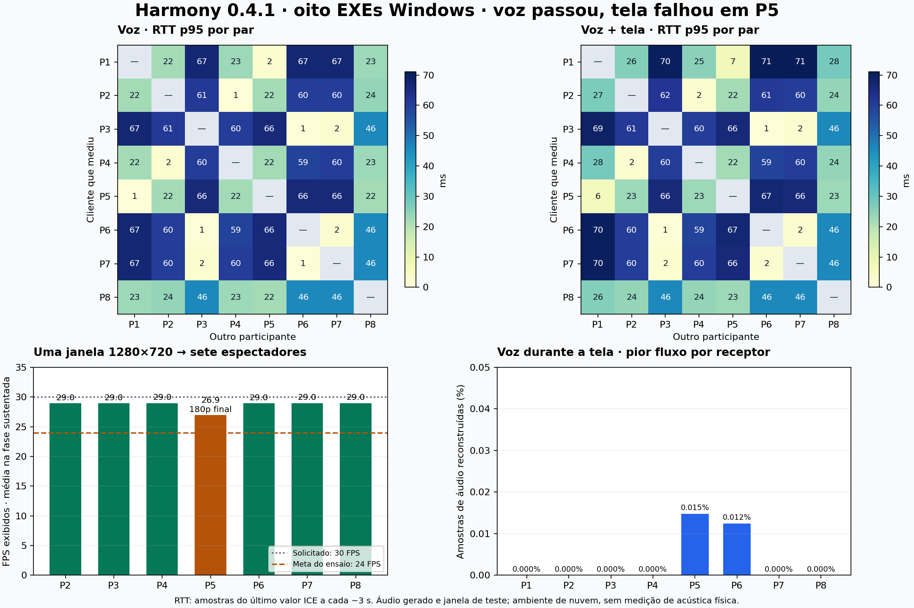

# Oito EXEs Windows em VMs externas — 15/11/2026

Registro histórico da primeira rodada 0.4.1. O [resultado posterior 0.4.2](EXE-WAN-0.4.2.md) passou e é documentado separadamente; este FAIL não foi apagado ou reclassificado.

**Voz: PASS nos oito clientes. Tela: FAIL em um dos sete espectadores. Resultado geral: FAIL.** O teste automatizado executou a versão Windows publicada em oito VMs simultâneas, com oito IPs públicos distintos. Seis espectadores mantiveram 720p; P5 terminou em 180p e registrou seis congelamentos, somando 3,478 segundos. O produto e os critérios não foram alterados para aprovar o resultado.

[Execução completa 43673049591](https://github.com/BersaneV/Harmony/actions/runs/43673049591), head `4e20b0570765fc370a19c691f726d9b3c3336d03`, de 03:35:25 a 03:44:15 UTC. O job `client 4` reprovou a qualidade de vídeo; os demais concluíram. P1–P8 correspondem aos índices 0–7 dos logs. [Dados sanitizados e métricas por fluxo](evidence/exe-wan-0.4.1-20261115.json).



## Resultados sustentados

Cada fase teve 30 segundos fixos de acomodação, seguidos de pelo menos 180 segundos adicionais de medição. A fase de voz durou 180,569–180,805 s entre clientes; voz com tela, 180,605–181,045 s. Estatísticas foram coletadas aproximadamente a cada três segundos.

| Medida | Oito microfones | Oito microfones + uma tela |
|---|---:|---:|
| Conexões P2P confirmadas nas duas pontas | 28 | 28 |
| Fluxos direcionais de voz recebidos | 56 | 56 |
| RTT ICE mediano | 45 ms | 45 ms |
| RTT ICE p95 | 66 ms | 67 ms |
| RTT ICE máximo observado | 68 ms | 75 ms |
| Pior perda de pacotes de voz por fluxo | 0% | 0,0111% |
| Pior fração de amostras de voz reconstruídas por fluxo | 0,00581% | 0,01481% |
| Pior p95 de jitter de voz por fluxo | 1 ms | 3 ms |
| Clientes aprovados no critério de voz | 8/8 | 8/8 |
| Espectadores aprovados no critério de tela | N/A | 6/7 |

Os percentis de RTT agregam 3.416 leituras temporais por fase dos últimos valores ICE disponíveis. Não representam 3.416 sondagens STUN independentes. RTT é ida e volta da conectividade ICE; não mede atraso de fala até alto-falante nem captura até exibição. [Definição das estatísticas WebRTC](https://www.w3.org/TR/webrtc-stats/#dom-rtcicecandidatepairstats-currentroundtriptime).

A aprovação de voz exige sete fluxos recebidos por cliente, áudio não reconstruído equivalente a pelo menos 80% do tempo, reconstrução de no máximo 2% e RMS decodificado mínimo de 0,03. Os piores valores observados de áudio não reconstruído foram 99,9914% e 99,9873% do tempo; RMS mínimo, 0,3730 e 0,3740. Esses indicadores confirmam entrega e decodificação de fala gerada; não constituem nota de percepção humana, teste de eco ou validação acústica.

## Qualidade da tela e falha preservada

P1 capturou uma janela nativa própria animada, em 1280×720, e publicou pelos controles do aplicativo: 720p, 30 FPS, teto de 4 Mb/s por espectador, perfil movimento e áudio da tela desligado. Os outros sete assistiram com qualidade automática enquanto mantinham seus microfones. O codec efetivo foi H264 em todas as recepções.

| Espectador | FPS exibidos médios | Resolução final | Congelamentos / duração total | Resultado |
|---|---:|---|---|---|
| P2 | 28,971 | 1280×720 | 0 / 0 s | PASS |
| P3 | 28,968 | 1280×720 | 0 / 0 s | PASS |
| P4 | 28,980 | 1280×720 | 0 / 0 s | PASS |
| P5 | 26,926 | **320×180** | **6 / 3,478 s** | **FAIL** |
| P6 | 28,971 | 1280×720 | 0 / 0 s | PASS |
| P7 | 28,979 | 1280×720 | 0 / 0 s | PASS |
| P8 | 28,980 | 1280×720 | 0 / 0 s | PASS |

A meta previamente definida exige pelo menos 24 FPS médios exibidos **e 1280×720 em todas as amostras sustentadas**. A média de FPS de P5 não elimina sua reprovação por resolução. No receptor P5, as mudanças foram observadas aproximadamente em 117,4 s (960×540), 123,4 s (640×360), 126,4 s (480×270) e 132,4 s (320×180), permanecendo em 180p até o fim. São instantes amostrados, relativos ao começo da medição sustentada; não instantes exatos de transição.

A saída RTP correspondente no emissor também reduziu progressivamente a geometria codificada. Portanto a queda já existia antes da reprodução em P5. Houve zero perda de pacotes de vídeo contabilizada nesse fluxo, p95 de jitter de 4 ms e um quadro descartado pela reprodução. **A causa da adaptação permanece NOT_VERIFIED**: esta coleta não incluiu `qualityLimitationReason`, uso de CPU por encoder ou identificação independente do gargalo. Não atribuir a falha automaticamente à internet, CPU, servidor ou código do Harmony.

A fonte capturada teve mediana de 29 FPS. O envio somado de vídeo foi **2,894 Mb/s de payload** para sete espectadores, sem áudio, cabeçalhos ou outros custos de rede. A cena de teste é compressível; o ensaio não saturou o orçamento de 28 Mb/s correspondente aos sete tetos de 4 Mb/s. Jogos e vídeos com muito movimento exigem outra prova.

## Como o aplicativo foi exercitado

O workflow [exe-wan.yml](../.github/workflows/exe-wan.yml) usa oito jobs `windows-2022` standard, uma instalação publicada por VM, Windows Server 2022 Datacenter, quatro CPUs virtuais e aproximadamente 16 GiB por VM. A unicidade foi comprovada por HMAC dos UUIDs SMBIOS e dos IPs públicos de saída; os valores brutos não são publicados. O hostname da imagem clonada não foi usado como prova de independência. Oito IPs distintos não comprovam oito operadoras residenciais ou diversidade geográfica: são endpoints de um mesmo provedor de nuvem.

O instalador 0.4.1 tem 4.059.851 bytes, SHA-256 `509e30e8781876caa64ec8b36fc37ddb76bf868924717fd44ca6c109b7ab42bf`. O executável principal instalado teve o mesmo SHA-256 nos oito clientes: `9d4f95648030425dc97138a22c9fc2a42c251ff1f8e21da7c9e0246da84e9516`. A fonte do produto permanece `2ea5c8cfa6eb003d732dbcbe0c4a76ae73bc1f7d`. Nenhum novo EXE ou mudança da engine foi necessário para esta campanha.

A automação controla o WebView2 compilado em `http://tauri.localhost`, verifica a presença do Tauri e realiza login, entrada na comunidade/canal, microfone, publicação e foco da tela pelos controles existentes. Não importa a engine de desenvolvimento nem substitui o aplicativo por navegador/Vite. A observação envolve as APIs nativas preservando objetos, faixas, SDP e seleção de codec do produto. Os certificados observados nos dois clientes de cada par confirmaram 28 pares inversos nas duas fases. As rotas selecionadas foram UDP `srflx` ↔ `srflx`, sem relay TURN ou SFU.

Os oito microfones receberam frases geradas pelo SAPI do Windows. A tela usou `getDisplayMedia` real de uma janela WinForms própria, com HWND conferido, conteúdo colorido e quadros em movimento. O desktop da VM não aceitou mudança de resolução; a janela capturada foi independentemente conferida em 1280×720. O [preflight calibrado](https://github.com/BersaneV/Harmony/actions/runs/43673046317) passou e mediu 28,986 FPS. O helper opcional do seletor não encontrou um seletor aberto após a seleção automática; esse diagnóstico não foi transformado em PASS, e a captura real foi comprovada pelo HWND e pelos frames.

As VMs usaram GPU por software, foco emulado e perfis privados descartáveis. Os argumentos de teste e a porta CDP foram limitados ao ambiente remoto de QA, com acesso apenas em loopback e overrides WebView2 restritos ao nome desse executável. Não foram adicionados ao produto distribuído. Câmeras físicas, microfones pessoais, monitores ou janelas de terceiros não foram capturados.

## Calibração, custo e reprodução

A [primeira rodada completa](https://github.com/BersaneV/Harmony/actions/runs/43671856496) permanece FAIL: a fonte gerada avançava cerca de 21 FPS e a prova de identidade/certificados estava incompleta. Corrigiram-se somente o gerador nativo (STA/.NET Framework/timer) e a coleta de evidências (UUID real e fingerprint público nativo). O produto, os 180 segundos de medição e a meta de qualidade foram preservados. A rodada calibrada acima é a conclusão desta campanha; não foi repetida até obter aprovação de tela.

**Custo contratado: R$ 0.** Usaram-se runners standard do repositório pessoal público, sem runners maiores, caches ou upload de artifacts. O GitHub informa que runners standard em repositórios públicos são gratuitos. [Política de cobrança](https://docs.github.com/en/actions/concepts/billing-and-usage). A instância Altare gratuita existente apenas coordenou autenticação/sinalização e fixtures privadas; a mídia foi direta entre clientes. Não houve contratação de relay, alteração da hospedagem ou dependência de um servidor no Mac.

Todos os jobs terminaram e os clientes saíram da chamada. O secret temporário `HARMONY_EXE_WAN_SEED` foi removido; os dois secrets de assinatura do atualizador foram preservados. As contas/comunidades sintéticas ficam restritas às próprias fixtures, sem associação automática dos usuários reais. Nenhum `config.toml` foi alterado.

Para reproduzir, o proprietário deve criar uma nova semente aleatória como secret temporário `HARMONY_EXE_WAN_SEED` e disparar manualmente `exe-wan-probe.yml` e depois `exe-wan.yml` na `main` pública de `BersaneV/Harmony`. Não imprimir a semente. O harness recusa repositório, ambiente ou origem fora do recorte e usa apenas o instalador com hash fixado. Não há agenda recorrente. Ao terminar, remover o secret e baixar os logs:

```sh
gh run view ID_DA_EXECUCAO --log > run.log
node scripts/exe-wan/report.mjs run.log report.json
node --test scripts/exe-wan/metrics.test.mjs
# Em um venv de QA: matplotlib==3.9.4 e numpy==2.0.2
python scripts/exe-wan/plot.py report.json network-quality.png
```

Este resultado comprova o ensaio de oito EXEs em VMs externas com IPs distintos. Permanecem sem validação: PCs Windows físicos e redes residenciais/5G, NAT restritivo que exige relay, acústica/eco, áudio do sistema, atualização com o aplicativo em uso, várias telas/câmeras, jogos, 1440p/2160p, 60 FPS e uso prolongado. O próximo diagnóstico de desempenho deve explicar a redução do encoder de P5, preservando a falha e os mesmos critérios de comparação.
