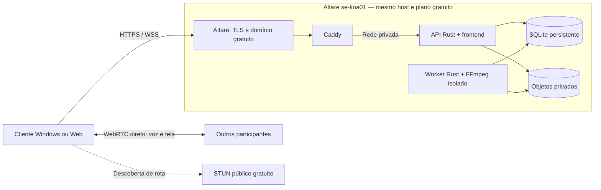

# Instância externa gratuita — 14/11/2026

Servidor para o cliente Windows e navegador: **https://harmony.go.altare.global**. No campo de servidor do `.exe` 0.4.1, informe essa origem, sem `/api`. As contas, senhas, comunidades, mensagens e anexos do piloto foram migrados; cada comunidade continua controlando a entrada dos membros. O endereço temporário `trycloudflare.com` foi aposentado.

## Hospedagem e orçamento

A instância usa a conta pessoal na Altare, equipe Default, plano **Always Free**, sem cartão, compra de créditos, plano pago ou upgrade automático. API, frontend, banco, arquivos e worker estão no mesmo nó `se-kna01`, em Karlskrona, Suécia. O gateway HTTPS também está nesse nó. São dois serviços do mesmo provedor, dentro da mesma hospedagem; nenhum servidor do Mac participa do atendimento.

| Serviço | Recursos configurados | Função |
|---|---|---|
| Generic Debian nativo | 1024 MiB RAM, 75% CPU, 5120 MiB disco | API Rust, frontend estático, SQLite, objetos privados e worker isolado |
| Docker App Caddy | 256 MiB RAM, 25% CPU, 1024 MiB disco | Entrada HTTPS/WSS do provedor e proxy para a rede privada |

Os dois diagnósticos americanos anteriores permanecem parados. Incluindo suas reservas, a equipe ocupa 2816/6144 MiB de RAM, 150/150% de CPU, 9216/10240 MiB de disco e 4/4 slots. Esses números são reservas, não consumo medido. Não ampliar recursos além do plano. A cota lógica de anexos continua em **1 GiB**, com **25 MiB por upload**; banco, runtime, temporários e snapshots têm consumo adicional.

A documentação do provedor declara plano sem prazo de teste e sem suspensão por ociosidade. Isso não oferece SLA nem garante que as condições comerciais permaneçam iguais no futuro. Nenhum recurso faturável foi habilitado. [Cadastro gratuito](https://altare.gg/en/help/getting-started/create-an-account), [planos e limites](https://docs.altare.gg/platform/plans) e [Docker Apps](https://docs.altare.gg/apps/docker).

## Caminho de execução



Caddy encaminha para `100.80.6.45:25094` na rede privada Altare. A entrada pública utiliza `https://harmony.go.altare.global`; não use o endereço HTTP da alocação nativa nem o alias diagnóstico `harmony-pessoal`. O gateway bloqueia `/api/internal/*`, limita uploads a 25 MiB e desabilita a administração HTTP do Caddy. A rede privada usa endereços do provedor; conferir e atualizar `gateway.json` caso o servidor seja recriado.

A mídia da chamada permanece P2P. Ela não atravessa o servidor sueco. O STUN público já configurado ajuda a descobrir a rota, sem armazenar chat ou anexos. Não há TURN/SFU ativo nesse perfil. Redes que impedem conexão direta podem falhar; este deploy não garante ping baixo entre quaisquer participantes. O bitrate escolhido é por destinatário: sete espectadores multiplicam o upload de quem transmite.

## Runtime e isolamento

O perfil nativo está em `infra/altare/`. Não usa o runner de imagens Docker para executar API/worker: o ensaio nesse runner recusou `exec` do supervisor após aplicar a política de filesystem. Esse ensaio não foi aprovado e não recebeu dados reais. O Docker App executa apenas Caddy.

O template nativo disponibilizou Linux 6.12.113, Landlock ABI 6, identidade real UID/GID 987, capabilities efetivas zero e `NoNewPrivs=1`. `launch.py` exige identidade real sem root, diretórios privados, hashes do pacote e Landlock, e recusa iniciar quando essas condições falham. A política do processo permite leitura do runtime e escrita apenas em estado/temporários privados. Os negativos de escrita fora dessas áreas e execução a partir de diretório gravável foram negados pelo kernel.

O supervisor original executa `harmony-media-worker --check-sandbox` antes de admitir a API. FFmpeg/ffprobe mantêm o próprio Landlock/seccomp, restrições de leitura, ausência de rede, limites de CPU/memória/arquivo e argumentos fixos. O worker real produziu miniaturas e MP4 faststart nesta hospedagem; a API é encerrada se um processo obrigatório morrer.

**Diferença para Compose:** os temporários nativos `data/worker-temp-state` e `data/sqlite-temp-state` são diretórios privados em disco, separados entre si. Não são os tmpfs de 128 MiB do Compose. O limite físico é o disco do serviço; a rotina de limpeza/limites do worker continua ativa. O perfil nativo não herda a prova de tmpfs, UID 10001, rede do host ou teto de processos do Compose. O restante do processo fica protegido pela política Landlock aplicada no início; isso não torna o volume do provedor um mount somente leitura.

## Pacotes fixados

| Componente | Identificação |
|---|---|
| Servidor Linux x86_64 | `harmony-server-0.4.1-linux-x86_64.tar.gz`, 35114400 bytes |
| SHA-256 do pacote | `d6e8ab6233fd3540b586247bd19d86ef8e48eaa9789f611105662ea86531dc3d` |
| Produto validado | `2ea5c8cfa6eb003d732dbcbe0c4a76ae73bc1f7d` |
| Empacotamento Linux | `f03f30344ca5c7fbd5697142dfc70580de869cc0` |
| Adaptador e ensaio externo | `5b31d545363183ccc9a6d86316f5c2166d9cd026` |
| Python de inicialização | CPython 3.13.18, Astral python-build-standalone 20261110, hash em `infra/altare/python-runtime.json` |
| Caddy | `caddy@sha256:003a97808e781aa9f7e75cc2f43d34d461099031faf5e20faefb9f61126836f0` |

O pacote Linux e seu manifesto estão na [release 0.4.1](https://github.com/BersaneV/Harmony/releases/tag/v0.4.1). O carregador verifica o arquivo comprimido, o manifesto e cada arquivo, inclusive quando usa cache. Recusa links, travessia de diretórios, arquivos especiais e extração excessiva. Não há download de código escolhido por usuários. Os avisos de licença acompanham o pacote e o runtime Python mantém seus arquivos de licença.

O `.exe` publicado não foi substituído: `Harmony_0.4.1_x64-setup.exe`, SHA-256 `509e30e8781876caa64ec8b36fc37ddb76bf868924717fd44ca6c109b7ab42bf`. Atualizações continuam pelo feed assinado existente.

## Configuração e reinício

No serviço Debian, `/home/container/native-bootstrap.sh` prepara o Python fixado, copia a configuração privada e inicia `/home/container/harmony-launch.py`. O comando salvo no painel é:

```sh
bash /home/container/native-bootstrap.sh
```

A configuração JSON privada fica em `/home/container/harmony-config.json`, modo 0600. Nunca versioná-la. O carregador recusa chaves duplicadas. Os campos `HARMONY_PUBLIC_API_URL` e `HARMONY_PUBLIC_ORIGIN` apontam para a origem HTTPS; as três origens Tauri também estão autorizadas. `HARMONY_DEPLOYMENT_SLOT=state` seleciona os dados reais. O slot `acceptance` é exclusivamente descartável. Caminhos de banco, storage, binários, health e temporários são fixados pelo carregador para esse perfil.

O banco persistente está em `/home/container/data/harmony-state/harmony.db`; os objetos, em `harmony-state/files`. A configuração inicial preservou a chave JWT e as senhas existentes. Chaves de assinatura do updater permanecem fora da hospedagem da aplicação.

No Caddy, o arquivo persistente `/data/harmony-Caddy.json` corresponde a `infra/altare/gateway.json`. Comando salvo:

```sh
caddy run --config /data/harmony-Caddy.json
```

No painel pessoal Altare, iniciar/reiniciar esses dois serviços é suficiente. O CLI oficial `altr` também permite `server start`, `server stop`, `server restart`, `files get/put` e `snapshots ls/take`. Conferir a equipe e o serviço antes de cada operação. Uma reinicialização encerra chamadas em andamento; os participantes entram novamente pelo canal. Alterações de recursos exigem conferir o valor salvo e reiniciar para aplicação.

## Backup e recuperação

A migração parou os escritores locais, fez backup SQLite consistente, verificou `integrity_check`, zero violações de FK, contagens de todas as tabelas e SHA-256 de todos os objetos. A importação recusou destino existente e conferiu os mesmos dados antes de iniciar a API. A cópia anterior permanece privada para recuperação; não é usada em tempo de execução.

Para um novo backup consistente, pare o serviço nativo, confirme no painel que está parado e que `/health` fica indisponível. Crie um **snapshot manual gratuito**, confira a conclusão e só então inicie novamente. O plano oferece três slots compartilhados; não ativar snapshots automáticos pagos. Preserve também uma cópia privada verificável de banco, objetos, configuração e hashes fora do volume ativo. Segredos/configuração exigem armazenamento privado, preferencialmente criptografado.

O primeiro snapshot externo terminou com estado `completed`, 245609337 bytes, ocupando 1/3 slots gratuitos. O serviço permaneceu parado durante a captura e foi iniciado depois da conclusão. O arquivo de importação e o slot descartável foram removidos do volume ativo depois de preservar esse snapshot; o comando permanente não importa nem sobrescreve dados no reinício. Snapshots diários pagos permanecem desativados.

Restauração substitui dados: primeiro preserve o estado atual e pare os escritores; restaure em destino novo quando possível, confira hashes/integridade e configuração do gateway. Revalide login, ACL, mensagens, downloads, worker e reinício antes do corte. Não restaurar a antiga cópia do Mac sobre dados externos que receberam novas mensagens: seria perda de gravações e exige reconciliação. A migração comprovou boot em outro host; o fluxo destrutivo de restauração do snapshot Altare ainda não foi ensaiado.

## Evidências e limites

- [Build Linux verificado](https://github.com/BersaneV/Harmony/actions/runs/43617870732): binários e frontend do produto 0.4.1, sem recompilar ou substituir o instalador assinado.
- [Oito clientes contra a API externa](https://github.com/BersaneV/Harmony/actions/runs/43625293821): PASS funcional, qualidade e moderação. Após 30 s de acomodação, 181,28 s de medição, 28 pares, 56 fluxos de microfone, sete espectadores e áudio da tela. Vídeo gerado 1280×720/30 FPS, médias exibidas 26,11–30,00 FPS; pior ocultação de áudio 0,463%, zero intervalos fora do orçamento de áudio.
- API externa/worker real: 21 critérios, com PNG, MP4, miniaturas privadas, faststart, hashes de originais, ACL de comunidade, assinatura de download, bloqueio de endpoint interno e CORS Tauri.
- Reinício dos dois serviços: conta, senha, sessão JWT, mensagem, originais e resultados do worker descartáveis preservados.
- Migração real: integridade e hashes iguais, login com senha administrativa anterior e contagens de contas/comunidades preservadas; antigo piloto local e túnel parados.
- Os seis originais reais foram baixados novamente do storage externo depois do reinício permanente; todos coincidem com os hashes da origem congelada.
- Todos os 13 arquivos do frontend, incluindo a entrada servida em `/`, coincidem com o pacote Linux pelo SHA-256. `/index.html` não é rota pública; a entrada é `/`.
- [Disponibilidade a partir de um runner externo](https://github.com/BersaneV/Harmony/actions/runs/43627871254): health, frontend e identidade 0.4.1/P2P/cadastro aberto passaram depois do desligamento do antigo piloto. O workflow usa um User-Agent próprio: a primeira tentativa com `Python-urllib` foi recusada na borda Cloudflare com 1010/403; identificar o cliente resolveu sem desabilitar proteção ou alterar o servidor.

O teste de oito clientes usa processos Chrome no mesmo runner Ubuntu, com captura sintética. A API/sinalização atravessa HTTPS/WSS até a Altare; a mídia P2P fica entre esses processos. Não é prova de oito computadores em redes diferentes, áudio/captura em Windows físico, ping Brasil–Brasil, 1440p/2160p ou oito telas simultâneas. A acomodação é registrada separadamente, não recebe PASS de qualidade. Amostragem não exclui interrupções menores que o intervalo medido. Consulte [validação](VALIDATION.md) e [chamadas P2P](P2P-CALLS.md).

CI final: [43628005539](https://github.com/BersaneV/Harmony/actions/runs/43628005539), fonte `8322db90bc48a6f12900e9b12a3aec49d3dd3941`, **SUCCESS em Linux e Windows**. Inclui os gates de integração, oito participantes, worker/sandbox/implantação supervisionada e geração/instalação/remoção do instalador comum no runner Windows. Confirma a correção do caminho de configuração. Alterações posteriores são documentais; nenhum novo instalador foi publicado e o EXE assinado 0.4.1 mantém o hash conferido acima.
