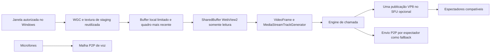

# Captura e codificação — candidata 0.4.3

A candidata troca a captura do navegador por Windows Graphics Capture para perfis de 60 FPS sem áudio do sistema. O usuário escolhe a janela e confirma a captura. A porta interna de captura informa a geometria efetiva, aplica limites de altura e FPS e encerra os recursos quando a transmissão termina. O microfone continua independente. A captura pelo navegador permanece disponível, inclusive para áudio do sistema.

O produtor nativo mantém um quadro pendente até o consumidor confirmar a cópia. Não transmite pixels em JSON ou base64, não acumula uma fila de quadros antigos e reutiliza os buffers. A espera usa um temporizador de alta resolução por produtor. A textura é validada antes da leitura; mudança de tamanho recria os recursos correspondentes. Uma fila WGC temporariamente vazia é tratada como ausência de quadro.

O SFU é opcional e exige `HARMONY_SCREEN_SFU_ENABLED=true` no servidor. Uma publicação de tela usa VP8, sem simulcast nem codec secundário. Voz e câmera continuam P2P. Cada espectador mantém o fallback até confirmar a decodificação da publicação atual, vinculada a SID e geração. Mudança de fonte, reconexão, mute e perda de acesso invalidam essa confirmação. Um espectador com limite de altura menor recebe sua transmissão P2P escalada; o SFU só atende um limite explícito quando existe um teto imutável comprovado para aquela geração.

Tokens de tela permitem apenas `screen_share` e `screen_share_audio`, sem publicação de dados nem alteração de metadata. A identidade vem da sessão e do participante ativo no canal. O gateway aceita somente as quatro rotas RTC, encaminha para LiveKit em loopback e mantém a admissão coordenada por identidade até a resposta inicial do servidor. Moderação e reconciliação usam a mesma coordenação e conferem novamente a autorização após operações externas.

A descoberta dessa capacidade tem orçamento próprio de 1,5 segundo: se o HTTP atrasar, a chamada tenta P2P. A requisição é abortada, respostas tardias são ignoradas e o WebSocket preserva seus 15 segundos de conexão. O teste de falha real abriu P2P em 1.507,2 ms enquanto a consulta estava deliberadamente pendente.

## Evidência disponível

Na [calibração do núcleo nativo](evidence/native-capture-0.4.3-calibration-20261116.json), em Windows 2022 descartável, os dois perfis entregaram a imagem inteira e ultrapassaram o gate de 54 quadros novos/s. A janela gerada tem resolução nativa; conteúdo fora da área visível também é conferido. Foram 5 segundos de acomodação e 10 segundos de medida.

| Perfil | Capturados/s | Conteúdo novo/s | Captura p95 | Resultado isolado |
|---|---:|---:|---:|---|
| 1080p60 | 57,87 | 56,38 | 5,01 ms | PASS |
| 1440p60 | 57,84 | 54,95 | 9,86 ms | PASS |

O mesmo workflow de 1440p passou na compilação, Clippy e testes da ponte real no Windows. As falhas anteriores permanecem registradas: captura GDI cortada, FPS insuficiente e interpretação incorreta do retorno nulo do pool WGC. Os testes de autorização também incluem uma reprodução de RPC atrasado após mute e conexões/renewals de um LiveKit real.

**A calibração isolada não aprova o instalador completo nem oito pessoas em 1080p60 ou 1440p60.** Faltam as medidas da candidata assinada com voz, codificação, WAN e reprodução por 180 segundos em cada perfil. O canal automático permanece na 0.4.2 até essa validação. A hospedagem descrita em [HOSTING.md](HOSTING.md) só muda após conferência do pacote, backup e teste do novo perfil; a existência do adaptador não comprova rede UDP ou capacidade do host.

Limites de escopo: Windows 10 compatível com WGC e WebView2 com SharedBuffer; a câmera e o microfone de pessoas não são usados nos ensaios. Uma confirmação nativa já aberta precisa ser fechada pelo usuário após cancelamento; o cancelamento impede iniciar a captura posteriormente. O SFU não adiciona E2EE ao produto. Seu fluxo de vídeo passa pelo servidor, enquanto a malha de voz continua direta quando a rede permite.
